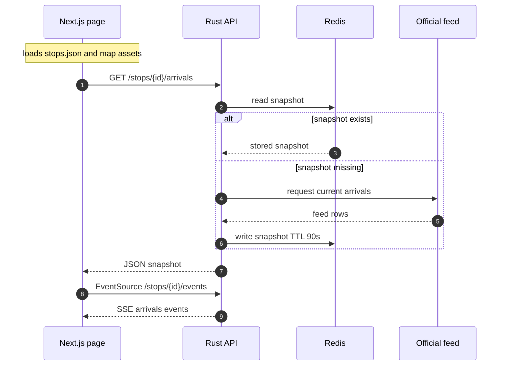

# Data sources

Realtime HK Traffic is built from official Hong Kong transport open data. The
Rust service is the only component that calls these hosts: it polls them, keeps
the latest arrival snapshot in Redis, and serves the page. The browser never
calls the feeds directly.

This page lists the sources this repository uses, the fields it reads, and the
files it keeps in the repository. It is not an index of every dataset on the
portal. Add new sources here when the service starts using them.

## At a glance

| Data | Publisher | Endpoint | Used for |
| --- | --- | --- | --- |
| MTR lines and stations | MTR open data | `https://opendata.mtr.com.hk/data/mtr_lines_and_stations.csv` | Station codes, names, line membership and station order |
| MTR next train | data.gov.hk | `https://rt.data.gov.hk/v1/transport/mtr/getSchedule.php` | Live train arrivals |
| MTR Bus and Feeder Bus | data.gov.hk | `https://rt.data.gov.hk/v1/transport/mtr/bus/getSchedule` | Live next-bus arrivals by route |
| KMB and LWB stops | data.gov.hk | `https://data.etabus.gov.hk/v1/transport/kmb/stop` | Bus stop catalogue |
| KMB and LWB stop detail | Transport Department / data.gov.hk | `https://data.etabus.gov.hk/v1/transport/kmb/stop/{stop_id}` | One stop's TC/SC/EN name and coordinates |
| KMB and LWB route list | Transport Department / data.gov.hk | `https://data.etabus.gov.hk/v1/transport/kmb/route/` | Route numbers, bound, service type, origins and destinations in TC/SC/EN |
| KMB and LWB route detail | Transport Department / data.gov.hk | `https://data.etabus.gov.hk/v1/transport/kmb/route/{route}/{direction}/{service_type}` | One route variant's origin and destination |
| KMB and LWB route-stop list | Transport Department / data.gov.hk | `https://data.etabus.gov.hk/v1/transport/kmb/route-stop/` | Ordered stops for every route variant |
| KMB and LWB route-stop detail | Transport Department / data.gov.hk | `https://data.etabus.gov.hk/v1/transport/kmb/route-stop/{route}/{direction}/{service_type}` | Ordered stops for one route variant |
| KMB and LWB ETA | data.gov.hk | `https://data.etabus.gov.hk/v1/transport/kmb/stop-eta/{stop_id}` | Live bus arrivals for every route at a stop |
| KMB and LWB route ETA | Transport Department / data.gov.hk | `https://data.etabus.gov.hk/v1/transport/kmb/eta/{stop_id}/{route}/{service_type}` | Live arrivals for one route at one stop |
| Citybus stops | data.gov.hk | `https://rt.data.gov.hk/v2/transport/citybus/...` | Citybus stop catalogue |
| Citybus ETA | data.gov.hk | `https://rt.data.gov.hk/v1/transport/batch/stop-eta/CTB/{stop_id}` | Live Citybus arrivals |
| Bus route information | Transport Department / data.gov.hk | `https://static.data.gov.hk/td/routes-fares-kml/KML_BUS.zip` | Route names, origins, destinations, fares and stop sequences in TC/SC/EN |
| Green minibus | data.gov.hk | `https://data.etagmb.gov.hk/...` | Stops, routes and live arrivals |
| GMB route information | Transport Department / data.gov.hk | `https://static.data.gov.hk/td/routes-fares-kml/KML_GMB.zip` | Route names, origins, destinations, fares and stop sequences in TC/SC/EN |
| Green minibus route numbers | data.gov.hk | `https://static.data.gov.hk/td/routes-fares-xml/ROUTE_GMB.xml` | Route id to route number labels |
| Taxi stands | data.gov.hk / CSDI | `https://portal.csdi.gov.hk/server/rest/services/...` | Stand names and coordinates |
| MTR line geometry | OpenStreetMap | `https://overpass-api.de/api/interpreter` | The coloured MTR line layer |

The service sends no API key. All feeds are public HTTP GET endpoints except the
MTR Bus feed, which uses POST.

## What the server actually uses

Short answer: no. Only the rows marked `Yes` in the Rust service column are
called at runtime. Catalogue rows marked `Optional` are fetched only when
`LIVE_CATALOGUES=1`; by default the service uses the bundled stops. The rest
are script-generated, web-only, or documented for future work.

| Source | Rust service | Scripts | Web | Notes |
| --- | --- | --- | --- | --- |
| MTR lines and stations CSV | Indirect | No | No | The server uses bundled `mtr.json`, not the CSV |
| MTR next train | Yes | No | No | Live station arrivals |
| MTR Bus and Feeder Bus | No | No | No | Documented only |
| KMB and LWB stop list | Optional | No | No | Bundled by default; live catalogue refresh with `LIVE_CATALOGUES=1` |
| KMB and LWB stop detail | No | No | No | Documented only |
| KMB and LWB route list | No | Yes | No | Night-stop generation |
| KMB and LWB route detail | No | No | No | Documented only |
| KMB and LWB route-stop list | No | No | No | Documented only |
| KMB and LWB route-stop detail | No | Yes | No | Night-stop generation |
| KMB and LWB stop ETA | Yes | No | No | Live bus arrivals |
| KMB and LWB route ETA | No | No | No | Documented only |
| Citybus ETA | Yes | No | No | Live bus arrivals |
| Citybus route and stop catalogues | Optional | Partial | No | Bundled by default; live crawl with `LIVE_CATALOGUES=1`; night-stop script uses route and route-stop |
| KML_BUS.zip | No | No | No | Documented only |
| GMB stop ETA | Yes | No | No | Live minibus arrivals |
| GMB route and stop catalogues | Optional | Partial | No | Bundled by default; live crawl with `LIVE_CATALOGUES=1`; scripts use route and route-stop |
| ROUTE_GMB.xml | No | No | No | Reference for bundled `gmb-routes.json` |
| KML_GMB.zip | No | No | No | Documented only |
| Taxi stands | Optional | No | No | Bundled by default; live catalogue refresh with `LIVE_CATALOGUES=1` |
| OpenStreetMap Overpass | No | Yes | Yes | Generates `mtr-lines.geojson`; map tiles are loaded by the page |
| `service-hours.json` | No | No | Yes | Web-only stop styling |
| `mtr-lines.geojson` | No | Generated | Yes | Web-only MTR line layer |

The checked-in stop catalogue is canonical in `server/data/stops.json`; the page
reads generated per-mode files under `web/public`. The server loads the bundled
stops first and only refreshes the live catalogues when `LIVE_CATALOGUES=1`.

## Static and dynamic data

**Static** data is checked in, or is publisher catalogue data that changes only
when routes, stops, schedules or the network change. **Dynamic** data is the
arrival information that changes continuously and is polled by the service.

### Static or reference data

| Data | Where it lives | Changes when |
| --- | --- | --- |
| MTR lines and stations CSV | Publisher reference | The rail network changes |
| `server/data/mtr.json` | Checked in | Station names, coordinates or lines change |
| `server/data/stops.json` | Checked in, canonical | The stop catalogue is regenerated |
| `server/data/gmb-routes.json` | Checked in | GMB route ids or numbers change |
| `web/public/service-hours.json` | Checked in | Service schedules change |
| `web/public/mtr-lines.geojson` | Checked in | Regenerated from OpenStreetMap |
| `KML_BUS.zip` and `KML_GMB.zip` | Publisher reference archives | Periodic publisher update; not polled |
| `ROUTE_GMB.xml` | Publisher reference | Periodic publisher update; not polled |
| KMB and LWB route and stop catalogues | Bundled; optional live refresh | Daily, or when routes and stops change |
| Citybus route and stop catalogues | Bundled; optional live refresh | Daily, or when routes and stops change |
| GMB route and stop catalogues | Bundled; optional live refresh | When routes and stops change |
| Taxi stand locations | Bundled; optional live refresh | When stands change |

### Dynamic or live data

| Data | Refresh | Where it lives |
| --- | --- | --- |
| MTR next train | Watched stations every 15s; all MTR stations every 60s | Redis snapshot, TTL 90s |
| KMB and LWB stop ETA | Publisher about every minute; service polls watched stops every 15s | Redis snapshot, TTL 90s |
| Citybus ETA | Publisher about every minute; service polls watched stops every 15s | Redis snapshot, TTL 90s |
| GMB stop ETA | Service polls watched stops every 15s | Redis snapshot, TTL 90s |
| MTR Bus and Feeder Bus ETA | Publisher says every 10s | Not integrated |
| Redis snapshots | Written on each successful refresh; expire after 90s | Redis |
| SSE arrival events | Pushed when a snapshot is refreshed | Browser stream |

Dynamic data is never committed to the repository. The only persisted copy is
the Redis snapshot, and it expires. Static data is the material a new server
starts from.

### Static data improvements

Static-data optimization opportunities and their measurements are tracked in
[improve.md](improve.md).

## MTR lines and stations

The station and line reference is the CSV published by MTR, linked from
data.gov.hk. It covers the heavy-rail network, **not Light Rail**.

Source dataset: [MTR Lines (except Light Rail) & Stations](https://data.gov.hk/en-data/dataset/mtr-data-routes-fares-barrier-free-facilities/resource/8daba4fe-b879-4a51-8962-27b4cffdc61c).

```text
https://opendata.mtr.com.hk/data/mtr_lines_and_stations.csv
```

Last checked on 20 November 2026: 270 non-empty rows, 97 unique station codes,
and 10 lines. The file ends with one blank row; skip rows with an empty
`Line Code` when parsing.

### Columns

| Column | Example | Meaning |
| --- | --- | --- |
| `Line Code` | `AEL` | Line identifier |
| `Direction` | `DT` | Travel direction along the line |
| `Station Code` | `AWE` | Three-letter station code used by the MTR feed |
| `Station ID` | `56` | MTR's numeric station id |
| `Chinese Name` | `博覽館` | Traditional Chinese station name |
| `English Name` | `AsiaWorld-Expo` | English station name |
| `Sequence` | `1.00` | Order of the station in that line and direction, starting at 1 |

Example rows:

```csv
"Line Code","Direction","Station Code","Station ID","Chinese Name","English Name","Sequence"
"AEL","DT","AWE","56","博覽館","AsiaWorld-Expo",1.00
"AEL","DT","AIR","47","機場","Airport",2.00
"AEL","DT","TSY","46","青衣","Tsing Yi",3.00
"AEL","DT","KOW","45","九龍","Kowloon",4.00
"AEL","DT","HOK","44","香港","Hong Kong",5.00
```

### Lines in the file

| Code | Line | Unique stations |
| --- | --- | ---: |
| `AEL` | Airport Express | 5 |
| `DRL` | Disneyland Resort Line | 2 |
| `EAL` | East Rail Line | 15 |
| `ISL` | Island Line | 17 |
| `KTL` | Kwun Tong Line | 17 |
| `SIL` | South Island Line | 5 |
| `TCL` | Tung Chung Line | 8 |
| `TKL` | Tseung Kwan O Line | 8 |
| `TML` | Tuen Ma Line | 27 |
| `TWL` | Tsuen Wan Line | 16 |

`DT` and `UT` are the normal down and up directions. Branch directions keep
separate sequences: `LMC-DT` and `LMC-UT` for the East Rail Lok Ma Chau branch,
and `TKS-DT` and `TKS-UT` for the Tseung Kwan O LOHAS Park branch.

### What the CSV does not contain

The CSV has no coordinates and no line colours. The repository keeps its own
station lookup in `server/data/mtr.json`, one object per station:

```json
{
  "code": "CEN",
  "name_tc": "中環",
  "name_en": "Central",
  "lat": 22.282,
  "lng": 114.1577,
  "lines": ["TWL", "ISL"]
}
```

That file has 98 stations. It includes `RAC` (馬場 Racecourse), which the CSV
does not list, and adds the latitude, longitude and line membership needed to
draw station pins and query the next-train feed. `catalog::mtr_stops()` reads it
to build `mtr:` stops, and `catalog::mtr_label()` uses the names to label train
destinations. `server/scripts/build-mtr-catalogue.py` syncs the `mtr:` rows in
`stops.json` and writes `web/app/mtr-line-terminals.json` from this file and the
CSV.

Line colours and the human-readable station lists are in [MTR.md](MTR.md).

## MTR next train

Real-time MTR train information. The feed is the MTR Next Train dataset on
data.gov.hk:

Source dataset: [Real-time MTR train information](https://data.gov.hk/en-data/dataset/mtr-data2-nexttrain-data/resource/103472ed-01be-4dda-92c6-30530dee022f).

```text
https://rt.data.gov.hk/v1/transport/mtr/getSchedule.php?line={line}&sta={station}
```

Example: `line=TWL&sta=ADM`.

Fields the service reads:

| Field | Use |
| --- | --- |
| `data` | Object keyed by `{line}-{station}`, e.g. `TWL-ADM` |
| `data.*.UP`, `data.*.DOWN` | Train arrays for the two directions |
| `valid` | `N` trains are skipped |
| `dest` | Destination station code, resolved through `catalog::mtr_label()` |
| `ttnt` | Minutes until the train |
| `time` | Scheduled clock time; the page shows the time portion |
| `isdelay` | `Y` marks the whole station snapshot as delayed |

The service calls this for watched MTR stations every 15 seconds, and for every
MTR station once a minute.

## MTR Bus and Feeder Bus

Real-time MTR Bus and Feeder Bus schedule. The feed is the MTR Bus ETA dataset
on data.gov.hk:

Source dataset: [Real-time MTR Bus and Feeder Bus Schedule](https://data.gov.hk/en-data/dataset/mtr-mtr_bus-mtr-bus-eta-data/resource/f58a9043-2556-4770-bcdb-0a62ed8d206c).

The resource is published with an update frequency of every 10 seconds. It is a
`POST` endpoint, not a `GET`: the route and language go in a JSON body.

```text
POST https://rt.data.gov.hk/v1/transport/mtr/bus/getSchedule
Content-Type: application/json

{"language":"en","routeName":"K12"}
```

`language` is `en` for English or `zh` for Traditional Chinese. `routeName` is
the MTR Bus route, for example `K12`, `K51` or `506`. The API spec in
`https://opendata.mtr.com.hk/doc/MTR_BUS_API_Spec_v1.14.pdf` lists every valid
route name.

Response fields:

| Field | Meaning |
| --- | --- |
| `appRefreshTimeInSecond` | Suggested refresh interval in seconds |
| `routeName` | Route that was requested |
| `routeStatus`, `routeStatusColour`, `routeStatusTime` | Route-level status |
| `status` | Overall response status code |
| `footerRemarks` | Publisher note about the estimate |
| `busStop[]` | Stops on the route, in order |
| `busStop[].busStopId` | MTR Bus stop id |
| `busStop[].isSuspended` | `1` when the stop is suspended |
| `busStop[].bus[]` | Next buses for that stop |
| `bus[].busId` | Vehicle id |
| `bus[].lineRef` | Internal route and direction reference |
| `bus[].departureTimeInSecond`, `departureTimeText` | Seconds and human-readable text until departure |
| `bus[].arrivalTimeInSecond`, `arrivalTimeText` | Seconds and human-readable text until arrival |
| `bus[].busLocation` | Last known bus latitude and longitude |
| `bus[].isDelayed`, `isScheduled`, `busRemark` | Delay, timetable and remark flags |

The service does not poll this feed yet. The data dictionary is
`https://opendata.mtr.com.hk/doc/MTR_BUS_DataDictionary_v1.20.pdf`.

## Bus stops and arrivals

### KMB and LWB

Source dataset: [Real time Arrival Data of Kowloon Motor Bus and Long Win Bus Services](https://data.gov.hk/en-data/dataset/hk-td-tis_21-etakmb/resource/fcac14ed-23e4-433b-afd0-3c37d5c8e428).

Route list:

```text
https://data.etabus.gov.hk/v1/transport/kmb/route/
```

Last checked on 20 November 2026: 1,569 route variants and 770 unique route
numbers. The response includes LWB routes such as `A41` and `E33` alongside KMB
routes. The publisher updates the list once a day and asks clients to call it
after 05:00; it should not be polled like the ETA feed.

Each item in `data` is read as:

| Field | Use |
| --- | --- |
| `route` | Route number |
| `bound` | Direction, `O` or `I` |
| `service_type` | Route variant |
| `orig_tc`, `orig_sc`, `orig_en` | Origin in Traditional Chinese, Simplified Chinese and English |
| `dest_tc`, `dest_sc`, `dest_en` | Destination in Traditional Chinese, Simplified Chinese and English |

`server/scripts/fetch-night-stops.py` uses this list to find overnight routes.
The Rust service itself uses the stop and ETA endpoints below.

Single route variant:

```text
https://data.etabus.gov.hk/v1/transport/kmb/route/{route}/{direction}/{service_type}
```

Source dataset: [Route Data](https://data.gov.hk/en-data/dataset/hk-td-tis_21-etakmb/resource/75364cea-abff-4e85-b0d2-38a21ad8c8a8).
`direction` is `outbound` or `inbound`; `service_type` is the variant number
from the route list. The response is a single `data` object with the same fields
as a route-list row: `route`, `bound`, `service_type`, `orig_tc/sc/en` and
`dest_tc/sc/en`. This resource is also updated once a day and should be fetched
after 05:00, not polled.

Route-stop data:

The full list returns every route-stop pair at once:

Source dataset: [Route-Stop List Data](https://data.gov.hk/en-data/dataset/hk-td-tis_21-etakmb/resource/d8c9ef3e-e4c9-4786-aaa6-9a3bd7a5d8c7).
The full list is served at the following URL, including the trailing slash.

```text
https://data.etabus.gov.hk/v1/transport/kmb/route-stop/
```

Last checked on 20 November 2026: 35,776 rows across 770 routes. Like the other
catalogue resources, it is updated once a day and should be fetched after 05:00
rather than polled.

For one route variant:

Source dataset: [Route-Stop Data](https://data.gov.hk/en-data/dataset/hk-td-tis_21-etakmb/resource/2dda0e97-fc4d-449c-bb98-a17228742eb4).
It returns the ordered stops for that route, direction and service type.

```text
https://data.etabus.gov.hk/v1/transport/kmb/route-stop/{route}/{direction}/{service_type}
```

Both responses have `data[]` rows containing `route`, `bound`, `service_type`,
`seq` and `stop`. `server/scripts/fetch-night-stops.py` uses the route list and
route-stop endpoints.

Stop catalogue:

Source dataset: [Stop List Data](https://data.gov.hk/en-data/dataset/hk-td-tis_21-etakmb/resource/3d6ded6c-ee36-40a0-a6fe-8f40966dff67).
The publisher updates this list once a day and asks clients to call it after
05:00; repeated calls do not return newer data.

```text
https://data.etabus.gov.hk/v1/transport/kmb/stop
```

Each item in `data` is read as:

| Field | Use |
| --- | --- |
| `stop` | Stop id, stored as `bus:kmb:{stop}` |
| `name_tc`, `name_sc`, `name_en` | Stop name in Traditional Chinese, Simplified Chinese and English |
| `lat`, `long` | WGS84 coordinates, parsed from strings |

Single stop:

Source dataset: [Stop Data](https://data.gov.hk/en-data/dataset/hk-td-tis_21-etakmb/resource/31ee7ca9-d9ef-42cb-8c11-cca2876650fb).
The stop id is the 16-character id returned by the route-stop endpoint. Like the
stop list, this resource is updated once a day and should be fetched after 05:00.

```text
https://data.etabus.gov.hk/v1/transport/kmb/stop/{stop_id}
```

The response has one `data` object with `stop`, `name_tc`, `name_sc`, `name_en`,
`lat` and `long`.

Live arrivals at one stop:

Source dataset: [Stop ETA Data](https://data.gov.hk/en-data/dataset/hk-td-tis_21-etakmb/resource/12185102-718d-4d03-bfd7-b9ecf760aee2).
The ETA data is updated every minute and covers every route at the stop.

```text
https://data.etabus.gov.hk/v1/transport/kmb/stop-eta/{stop_id}
```

Each item in `data` is read as:

| Field | Use |
| --- | --- |
| `route` | Route number |
| `dest_tc` (or `dest`) | Destination |
| `eta` | ISO timestamp used to calculate minutes remaining |

The rows also carry `co`, `dir`, `service_type`, `seq`, `dest_sc`, `dest_en`,
`eta_seq`, `rmk_tc`, `rmk_sc`, `rmk_en` and `data_timestamp`.

Single stop and route ETA:

Source dataset: [ETA Data](https://data.gov.hk/en-data/dataset/hk-td-tis_21-etakmb/resource/2ea2591f-67e7-488d-83de-96ed48def51e).
The ETA data is updated every minute. The response may contain up to three
arrivals for each direction.

```text
https://data.etabus.gov.hk/v1/transport/kmb/eta/{stop_id}/{route}/{service_type}
```

Each item in `data` is read as:

| Field | Use |
| --- | --- |
| `co` | Operator code, such as `KMB` or `LWB` |
| `route` | Route number |
| `dir` | Direction, `O` or `I` |
| `service_type` | Route variant |
| `seq` | Stop sequence on the route |
| `dest_tc`, `dest_sc`, `dest_en` | Destination in TC, SC and English |
| `eta_seq` | Arrival order at this stop |
| `eta` | Estimated arrival time |
| `rmk_tc`, `rmk_sc`, `rmk_en` | Remark in TC, SC and English |
| `data_timestamp` | Time the estimate was generated |

### Citybus

Source dataset: [Real-time “Next Bus” arrival time and related data of Citybus](https://data.gov.hk/en-data/dataset/ctb-eta-transport-realtime-eta).
Resources: [Route data](https://data.gov.hk/en-data/dataset/ctb-eta-transport-realtime-eta/resource/06b172c1-0e7b-434a-bdcb-1c0a0abe8328), [Bus Stop data](https://data.gov.hk/en-data/dataset/ctb-eta-transport-realtime-eta/resource/cbc9bfb4-248d-42ba-aba7-1dd5259563f0), [Route-stop data](https://data.gov.hk/en-data/dataset/ctb-eta-transport-realtime-eta/resource/eae263c1-ef5d-4840-a1ff-0b7521febd8b), [ETA data](https://data.gov.hk/en-data/dataset/ctb-eta-transport-realtime-eta/resource/4c5220eb-b4a0-4bd8-a7fe-5b46bc2e5012).

Citybus is loaded in three catalogue steps:

```text
https://rt.data.gov.hk/v2/transport/citybus/route/CTB
https://rt.data.gov.hk/v2/transport/citybus/route-stop/CTB/{route}/{direction}
https://rt.data.gov.hk/v2/transport/citybus/stop/{stop_id}
```

`direction` is `outbound` or `inbound`. The service reads `data[].route` from the
route list, `data[].stop` from route-stop, and `data.stop`, `data.name_tc`,
`data.name_en`, `data.lat` and `data.long` from the stop document.

Live arrivals:

```text
https://rt.data.gov.hk/v1/transport/batch/stop-eta/CTB/{stop_id}
```

The arrival fields are the same ones the KMB feed uses: `route`, `dest_tc` (or
`dest`), and `eta`.

### Bus route information archive

The Transport Department publishes bus route metadata and stop sequences as a
ZIP of KML documents. Every route variant has a document with names in
Traditional Chinese, Simplified Chinese and English.

Source dataset: [Route information of bus (English / Traditional Chinese / Simplified Chinese)](https://data.gov.hk/en-data/dataset/hk-td-tis_24-routes-fares-kml/resource/774aef95-bd93-4f95-9dba-8c109ae7d148).

```text
https://static.data.gov.hk/td/routes-fares-kml/KML_BUS.zip
```

Last checked on 20 November 2026: 1,622 `.kml` files, 4.96 MB zipped and about
51.6 MB uncompressed. There are 1,020 unique Traditional Chinese route names
across the files. Company codes in the checked copy:

| `companyCode` | Files |
| --- | ---: |
| `KMB` | 795 |
| `CTB` | 479 |
| `KMB+CTB` | 126 |
| `LWB` | 89 |
| `NLB` | 61 |
| `LRTFeeder` | 32 |
| `XB` | 16 |
| `DB` | 12 |
| `PI` | 9 |
| `LWB+CTB` | 3 |

Each KML document has route-level `ExtendedData`:

| Field | Meaning |
| --- | --- |
| `routeId` | Route variant id; also the file name and Document id |
| `companyCode` | Operator code, such as `KMB`, `CTB`, `LWB` or `NLB` |
| `routeNameC`, `routeNameS`, `routeNameE` | Route number or name in TC, SC and English |
| `routeType` | Route type code |
| `serviceMode` | Service mode code; the checked copy contains `T`, `R`, `NT` and `N` |
| `specialType` | Special route flag |
| `journeyTime` | Journey time in minutes |
| `locStartNameC`, `locStartNameS`, `locStartNameE` | Origin name in TC, SC and English |
| `locEndNameC`, `locEndNameS`, `locEndNameE` | Destination name in TC, SC and English |
| `hyperlinkC`, `hyperlinkS`, `hyperlinkE` | Operator page for the route in each language |
| `fullFare` | Full fare |
| `routeRemarkC`, `routeRemarkS`, `routeRemarkE` | Route remarks in TC, SC and English |
| `lastUpdateDate` | Publisher's last update timestamp |

Each stop is a KML `Placemark` with:

| Field | Meaning |
| --- | --- |
| `routeSeq` | Direction or route variant sequence |
| `stopSeq` | Stop order on that sequence, starting at 1 |
| `stopId` | Stop id |
| `stopPickDrop` | Pick-up and drop-off indicator |
| `stopNameC`, `stopNameS`, `stopNameE` | Stop name in TC, SC and English |
| `Point/coordinates` | Longitude, latitude |

The checked archive contains `Point` placemarks only. It does not include
`LineString` route geometry. The service does not poll this archive yet; it is a
reference for route labels, fares, stop sequences and multilingual stop names.

## Green minibus

Source dataset: [Real-time arrival data of green minibuses (GMBs)](https://data.gov.hk/en-data/dataset/hk-td-sm_7-real-time-arrival-data-of-gmb).

The green-minibus API is `https://data.etagmb.gov.hk`. The service uses five
resources:

| Endpoint | Source resource | Fields read |
| --- | --- | --- |
| `/route` | [GMB route list](https://data.gov.hk/en-data/dataset/hk-td-sm_7-real-time-arrival-data-of-gmb/resource/02913a6d-e520-4232-bdd5-eef86a906631) | `data.routes.{region}[]` route codes |
| `/route/{region}/{route}` | [GMB route data](https://data.gov.hk/en-data/dataset/hk-td-sm_7-real-time-arrival-data-of-gmb/resource/f003e716-e8cf-4511-b315-2a86c9b26ce0) | `data[].route_id` and `data[].directions[].route_seq` |
| `/route-stop/{route_id}/{route_seq}` | [GMB stop list of specific route](https://data.gov.hk/en-data/dataset/hk-td-sm_7-real-time-arrival-data-of-gmb/resource/b22d3e1a-78a2-40fa-a939-d2dbe5a9a27f) | `data.route_stops[].stop_id`, `.name_tc` |
| `/stop/{stop_id}` | [GMB stop data](https://data.gov.hk/en-data/dataset/hk-td-sm_7-real-time-arrival-data-of-gmb/resource/77fe99f2-bcfa-4691-a5c0-a4d67484afca) | `data.coordinates.wgs84.latitude`, `.longitude` |
| `/eta/stop/{stop_id}` | [ETA list of a specific GMB stop](https://data.gov.hk/en-data/dataset/hk-td-sm_7-real-time-arrival-data-of-gmb/resource/09d817d8-470a-4d12-82ff-c09555360c97) | `data[].route_id`, `data[].eta[].diff`, `.remarks_tc` |

The catalogue crawl is expensive and is throttled by the publisher. The
bundled stop list in `server/data/stops.json` is the baseline; the live crawl
can refresh the stop catalogue and extend the route-number map at runtime.

Route numbers are not the internal `route_id`. The complete static reference is
the Transport Department file:

```text
https://static.data.gov.hk/td/routes-fares-xml/ROUTE_GMB.xml
```

Source dataset: [Routes and fares of public transport (XML), GMB resource](https://data.gov.hk/en-data/dataset/hk-td-tis_14-routes-fares-xml/resource/36ae3d06-17fd-443c-bd7f-a2b543dfc981).

It is bundled as `server/data/gmb-routes.json`, mapping numeric route ids to the
route numbers printed on the minibus. Generate the map offline from
`KML_GMB.zip`; the GMB API crawl only merges routes newer than the archive.

### GMB route information archive

The same Transport Department collection also publishes green-minibus route
metadata as KML documents:

Source dataset: [Route information of GMB (English / Traditional Chinese / Simplified Chinese)](https://data.gov.hk/en-data/dataset/hk-td-tis_24-routes-fares-kml/resource/bb5a9797-3876-4a04-9e6c-78a06351e69d).

```text
https://static.data.gov.hk/td/routes-fares-kml/KML_GMB.zip
```

Last checked on 20 November 2026: 779 `.kml` files, 1.68 MB zipped and about
13.7 MB uncompressed. The archive has 480 unique Traditional Chinese route
names, and every file has `companyCode` `GMB`. Service mode values are `R`
(407 files), `T` (335), `N` (23) and `NT` (14).

The route-level and stop-level fields are the same as the bus archive above:
`routeNameC/S/E`, `locStartNameC/S/E`, `locEndNameC/S/E`, `fullFare`,
`stopSeq`, `stopNameC/S/E` and point coordinates. The checked archive also
contains no `LineString` route geometry.

The file name and `routeId` match the green-minibus API `route_id`. The checked
archive has 779 route ids, the same count as the keys in
`server/data/gmb-routes.json`, so it can be used as a static multilingual route
lookup. The service does not read it yet.

## Taxi stands

Source dataset: [Taxi Stands](https://data.gov.hk/en-data/dataset/hk-td-tis_37-taxi-stands/resource/29635792-e286-402d-92bb-dc8586c649f7).

Taxi stands come from the CSDI feature service linked from data.gov.hk:

```text
https://portal.csdi.gov.hk/server/rest/services/common/td_rcd_1697081907714_17556/FeatureServer/0/query
```

The service pages through the layer 200 records at a time and asks for GeoJSON.
It reads:

| Field | Use |
| --- | --- |
| `properties.OBJECTID` | Stand id, stored as `taxi:{OBJECTID}` |
| `properties.Location_TC`, `Location_EN` | Stand name in both languages |
| `geometry.coordinates` | Longitude and latitude |

Hong Kong publishes stand locations, not vehicle positions, so a taxi stand has
no arrival rows.

## Checked-in files derived from these sources

| File | Contents |
| --- | --- |
| `server/data/mtr.json` | MTR station codes, names, coordinates, line membership |
| `server/data/stops.json` | Canonical bundled stop catalogue used by the Rust service |
| `web/public/stops.json` | Generated at build from the canonical catalogue |
| `web/public/stops-*.json` | Generated at build from the canonical catalogue, one file per mode |
| `server/data/gmb-routes.json` | Green-minibus route id to route number map |
| `web/app/mtr-line-terminals.json` | Generated line endpoint labels from the MTR CSV |
| `web/public/service-hours.json` | Per-mode, per-station and per-route service windows |
| `web/public/mtr-lines.geojson` | MTR line geometry from OpenStreetMap |

Generation scripts:

| Script | Source |
| --- | --- |
| `server/scripts/fetch-minibus-routes.py` | Green-minibus route, route-stop and stop API |
| `server/scripts/fetch-night-stops.py` | KMB and Citybus route and route-stop endpoints, used to set `night: true` |
| `server/scripts/fetch-mtr-lines.py` | OpenStreetMap Overpass API, not data.gov.hk |

## Caching and polling

- The service polls watched stops every 15 seconds. All MTR stations are
  refreshed once a minute.
- Each snapshot is written to Redis as `arrivals:{stop_id}` with a 90-second
  expiry.
- The web page reads `/stops/{id}/arrivals` and listens to
  `/stops/{id}/events`; it does not contact the publishers.

See [REDIS.md](REDIS.md) for the snapshot keys and expiry details.

## Not from data.gov.hk

- **Map tiles:** OpenStreetMap, credited on the map.
- **MTR line geometry:** OpenStreetMap, ODbL, extracted by
  `server/scripts/fetch-mtr-lines.py`.
- **Service hours:** checked-in schedule data in
  `web/public/service-hours.json`.

## Official portals

- data.gov.hk: <https://data.gov.hk/>
- MTR open data: <https://opendata.mtr.com.hk/>
- CSDI: <https://portal.csdi.gov.hk/>
- OpenStreetMap copyright: <https://www.openstreetmap.org/copyright>

## Data relationships

Read this section before changing the service. The first diagram is the big
picture; the second follows one arrival request.

Key ideas:

- The Rust service is the only component that calls upstream feeds.
- Checked-in files seed the stop catalogue and the map.
- Redis holds the latest snapshot for each stop.
- The page loads static map data and asks the API only for arrivals.

Detailed endpoints and fields are in the tables above.


The dotted live-stop edge is enabled only with `LIVE_CATALOGUES=1`. Without it,
the service uses the bundled stop catalogue.

### One arrival request

The service may already have a snapshot from its background poll. If not, the
request triggers a fetch and stores the result before answering.

The page also opens an SSE stream, so later snapshots for that stop arrive
without another request.


