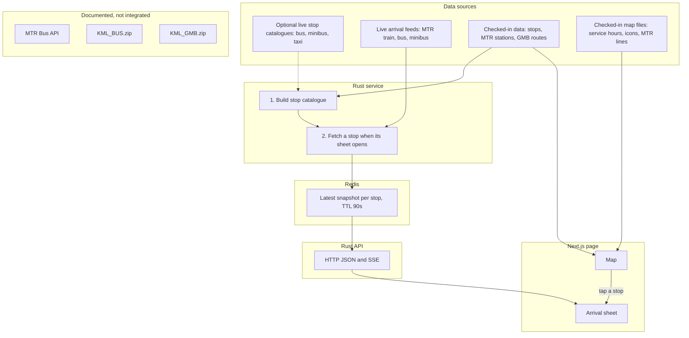
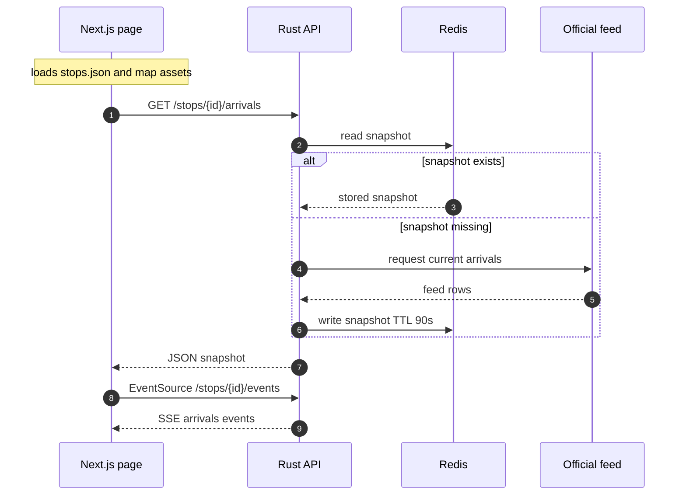

# Data sources

Realtime HK Traffic is built from official Hong Kong transport open data. The
Rust service is the only component that calls these hosts. It fetches a stop
when the map sheet asks, keeps that arrival snapshot in Redis for 90 seconds,
and serves the page. The browser never calls the feeds directly.

This page lists the sources this repository uses, the fields it reads, and the
files it keeps in the repository. It is not an index of every dataset on the
portal. Add new sources here when the service starts using them.

## At a glance

| Data | Publisher | Endpoint | Used for |
| --- | --- | --- | --- |
| MTR lines and stations | MTR open data | `https://opendata.mtr.com.hk/data/mtr_lines_and_stations.csv` | Station codes, names, line membership and station order |
| MTR next train | data.gov.hk | `https://rt.data.gov.hk/v1/transport/mtr/getSchedule.php` | Live train arrivals |
| MTR Bus and Feeder Bus | data.gov.hk | `https://rt.data.gov.hk/v1/transport/mtr/bus/getSchedule` | Live next-bus arrivals by route |
| KMB and LWB stops | data.gov.hk | `https://data.etabus.gov.hk/v1/transport/kmb/stop` | Bus stop catalogue |
| KMB and LWB stop detail | Transport Department / data.gov.hk | `https://data.etabus.gov.hk/v1/transport/kmb/stop/{stop_id}` | One stop's TC/SC/EN name and coordinates |
| KMB and LWB route list | Transport Department / data.gov.hk | `https://data.etabus.gov.hk/v1/transport/kmb/route/` | Route numbers, bound, service type, origins and destinations in TC/SC/EN |
| KMB and LWB route detail | Transport Department / data.gov.hk | `https://data.etabus.gov.hk/v1/transport/kmb/route/{route}/{direction}/{service_type}` | One route variant's origin and destination |
| KMB and LWB route-stop list | Transport Department / data.gov.hk | `https://data.etabus.gov.hk/v1/transport/kmb/route-stop/` | Ordered stops for every route variant |
| KMB and LWB route-stop detail | Transport Department / data.gov.hk | `https://data.etabus.gov.hk/v1/transport/kmb/route-stop/{route}/{direction}/{service_type}` | Ordered stops for one route variant |
| KMB and LWB ETA | data.gov.hk | `https://data.etabus.gov.hk/v1/transport/kmb/stop-eta/{stop_id}` | Live bus arrivals for every route at a stop |
| KMB and LWB route ETA | Transport Department / data.gov.hk | `https://data.etabus.gov.hk/v1/transport/kmb/eta/{stop_id}/{route}/{service_type}` | Live arrivals for one route at one stop |
| Citybus stops | data.gov.hk | `https://rt.data.gov.hk/v2/transport/citybus/...` | Citybus stop catalogue |
| Citybus ETA | data.gov.hk | `https://rt.data.gov.hk/v1/transport/batch/stop-eta/CTB/{stop_id}?lang=en` and `?lang=zh-Hant` | Live Citybus arrivals. One `lang` per request; the two responses are paired |
| Bus route information | Transport Department / data.gov.hk | `https://static.data.gov.hk/td/routes-fares-kml/KML_BUS.zip` | Route names, origins, destinations, fares and stop sequences in TC/SC/EN |
| Green minibus | data.gov.hk | `https://data.etagmb.gov.hk/...` | Stops, routes and live arrivals |
| GMB route information | Transport Department / data.gov.hk | `https://static.data.gov.hk/td/routes-fares-kml/KML_GMB.zip` | Route names, origins, destinations, fares and stop sequences in TC/SC/EN |
| Green minibus route numbers | data.gov.hk | `https://static.data.gov.hk/td/routes-fares-xml/ROUTE_GMB.xml` | Route id to route number labels |
| Ferry pier names | Transport Department / data.gov.hk | `https://static.data.gov.hk/td/routes-fares-xml/RSTOP_FERRY.xml` | Pier names in TC/SC/EN, joined to coordinates by stop id |
| Ferry pier coordinates | data.gov.hk / CSDI | `https://portal.csdi.gov.hk/server/rest/services/common/td_rcd_1671692797539_19916/FeatureServer/0/query` | Pier coordinates |
| HKKF ferry ETA | Hong Kong & Kowloon Ferry / data.gov.hk | `https://www.hkkfeta.com/opendata/eta/{route_id}/{direction}` | Next departure on an HKKF route |
| Sun Ferry ETA | Sun Ferry / data.gov.hk | `https://www.sunferry.com.hk/eta/?route={route_code}` | Arrival of the current trip, or the next departure when no arrival is published yet |
| Taxi stands | data.gov.hk / CSDI | `https://portal.csdi.gov.hk/csdi-webpage/file-api?dataset_id=td_rcd_1697081907714_17556&format=geojson&layer_name=Taxi_Stands` | Stand names, coordinates and taxi type |
| MTR line geometry | OpenStreetMap | `https://overpass-api.de/api/interpreter` | The coloured MTR line layer |

The service sends no API key. All feeds are public HTTP GET endpoints except the
MTR Bus feed, which uses POST.

## What the server actually uses

Short answer: no. Only the rows marked `Yes` in the Rust service column are
called at runtime. Catalogue rows marked `Optional` are fetched only when
`LIVE_CATALOGUES=1`; by default the service uses the bundled stops. The rest
are script-generated, web-only, or documented for future work.

| Source | Rust service | Scripts | Web | Notes |
| --- | --- | --- | --- | --- |
| MTR lines and stations CSV | Indirect | No | No | The server uses bundled `mtr.json`, not the CSV |
| MTR next train | Yes | No | No | Live station arrivals |
| MTR Bus and Feeder Bus | No | No | No | Documented only |
| KMB and LWB stop list | Optional | No | No | Bundled by default; live catalogue refresh with `LIVE_CATALOGUES=1` |
| KMB and LWB stop detail | No | No | No | Documented only |
| KMB and LWB route list | No | Yes | No | Night-stop generation |
| KMB and LWB route detail | No | No | No | Documented only |
| KMB and LWB route-stop list | No | No | No | Documented only |
| KMB and LWB route-stop detail | No | Yes | No | Night-stop generation |
| KMB and LWB stop ETA | Yes | No | No | Live bus arrivals |
| KMB and LWB route ETA | No | No | No | Documented only |
| Citybus ETA | Yes | No | No | Live bus arrivals |
| Citybus route and stop catalogues | Optional | Partial | No | Bundled by default; live crawl with `LIVE_CATALOGUES=1`; night-stop script uses route and route-stop |
| KML_BUS.zip | No | No | No | Documented only |
| GMB stop ETA | Yes | No | No | Live minibus arrivals |
| GMB route and stop catalogues | Optional | Partial | No | Bundled by default; live crawl with `LIVE_CATALOGUES=1`; scripts use route and route-stop |
| ROUTE_GMB.xml | No | No | No | Reference for bundled `gmb-routes.json` |
| KML_GMB.zip | No | No | No | Documented only |
| Ferry pier names and coordinates | No | Yes | No | Bundled. The script joins `RSTOP_FERRY.xml` to the CSDI pier layer |
| HKKF ferry ETA | Yes | No | No | Live departures for the piers in `ferry-departures.json` |
| Sun Ferry ETA | Yes | No | No | Live arrival or departure for the piers in `ferry-departures.json` |
| Taxi stands | Optional | No | Yes | Locations are bundled. `web/public/taxi-stands.geojson` supplies the taxi type the map uses to tint each icon |
| OpenStreetMap Overpass | No | Yes | Yes | Generates `mtr-lines.geojson`; map tiles are loaded by the page |
| `service-hours.json` | No | No | Yes | Web-only stop styling |
| `mtr-lines.geojson` | No | Generated | Yes | Web-only MTR line layer |

The checked-in stop catalogue is canonical in `server/data/stops.json`; the page
reads generated per-mode files under `web/public`. The server loads the bundled
stops first and only refreshes the live catalogues when `LIVE_CATALOGUES=1`.

## Static and dynamic data

**Static** data is checked in, or is publisher catalogue data that changes only
when routes, stops, schedules or the network change. **Dynamic** data is the
arrival information that changes continuously. The service fetches it when a
map stop is opened, not on a timer.

### Static or reference data

| Data | Where it lives | Changes when |
| --- | --- | --- |
| MTR lines and stations CSV | Publisher reference | The rail network changes |
| `server/data/mtr.json` | Checked in | Station names, coordinates or lines change |
| `server/data/stops.json` | Checked in, canonical | The stop catalogue is regenerated |
| `server/data/gmb-routes.json` | Checked in | GMB route ids or numbers change |
| `server/data/ferry-departures.json` | Checked in | An HKKF or Sun Ferry route changes pier |
| `web/public/service-hours.json` | Checked in | Service schedules change |
| `web/public/mtr-lines.geojson` | Checked in | Regenerated from OpenStreetMap |
| `KML_BUS.zip` and `KML_GMB.zip` | Publisher reference archives | Periodic publisher update; not polled |
| `ROUTE_GMB.xml` | Publisher reference | Periodic publisher update; not polled |
| KMB and LWB route and stop catalogues | Bundled; optional live refresh | Daily, or when routes and stops change |
| Citybus route and stop catalogues | Bundled; optional live refresh | Daily, or when routes and stops change |
| GMB route and stop catalogues | Bundled; optional live refresh | When routes and stops change |
| Taxi stand locations | Bundled; optional live refresh | When stands change |
| `web/public/taxi-stands.geojson` | Checked in | The stand list or a stand's taxi type changes |

### Dynamic or live data

| Data | Refresh | Where it lives |
| --- | --- | --- |
| MTR next train | Publisher every 10 seconds; fetched on click if the snapshot is missing | Redis snapshot, TTL 90s |
| KMB and LWB stop ETA | Publisher about every minute; fetched on click if the snapshot is missing | Redis snapshot, TTL 90s |
| Citybus ETA | Publisher about every minute; fetched on click if the snapshot is missing | Redis snapshot, TTL 90s |
| GMB stop ETA | Fetched on click if the snapshot is missing | Redis snapshot, TTL 90s |
| HKKF and Sun Ferry ETA | Publisher about every minute; fetched on click if the snapshot is missing | Redis snapshot, TTL 90s |
| MTR Bus and Feeder Bus ETA | Publisher says every 10s | Not integrated |
| Redis snapshots | Written on a successful click fetch; expire after 90s | Redis |
| SSE arrival events | Pushed with the snapshot from that click | Browser stream |

Dynamic data is never committed to the repository. The only persisted copy is
the Redis snapshot, and it expires. Static data is the material a new server
starts from.

### Static data improvements

Static-data optimization opportunities and their measurements are tracked in
[improve.md](improve.md).

## MTR lines and stations

The station and line reference is the CSV published by MTR, linked from
data.gov.hk. It covers the heavy-rail network, **not Light Rail**.

Source dataset: [MTR Lines (except Light Rail) & Stations](https://data.gov.hk/en-data/dataset/mtr-data-routes-fares-barrier-free-facilities/resource/8daba4fe-b879-4a51-8962-27b4cffdc61c).

```text
https://opendata.mtr.com.hk/data/mtr_lines_and_stations.csv
```

Last checked on 20 November 2026: 270 non-empty rows, 97 unique station codes,
and 10 lines. The file ends with one blank row; skip rows with an empty
`Line Code` when parsing.

### Columns

| Column | Example | Meaning |
| --- | --- | --- |
| `Line Code` | `AEL` | Line identifier |
| `Direction` | `DT` | Travel direction along the line |
| `Station Code` | `AWE` | Three-letter station code used by the MTR feed |
| `Station ID` | `56` | MTR's numeric station id |
| `Chinese Name` | `博覽館` | Traditional Chinese station name |
| `English Name` | `AsiaWorld-Expo` | English station name |
| `Sequence` | `1.00` | Order of the station in that line and direction, starting at 1 |

Example rows:

```csv
"Line Code","Direction","Station Code","Station ID","Chinese Name","English Name","Sequence"
"AEL","DT","AWE","56","博覽館","AsiaWorld-Expo",1.00
"AEL","DT","AIR","47","機場","Airport",2.00
"AEL","DT","TSY","46","青衣","Tsing Yi",3.00
"AEL","DT","KOW","45","九龍","Kowloon",4.00
"AEL","DT","HOK","44","香港","Hong Kong",5.00
```

### Lines in the file

| Code | Line | Unique stations |
| --- | --- | ---: |
| `AEL` | Airport Express | 5 |
| `DRL` | Disneyland Resort Line | 2 |
| `EAL` | East Rail Line | 15 |
| `ISL` | Island Line | 17 |
| `KTL` | Kwun Tong Line | 17 |
| `SIL` | South Island Line | 5 |
| `TCL` | Tung Chung Line | 8 |
| `TKL` | Tseung Kwan O Line | 8 |
| `TML` | Tuen Ma Line | 27 |
| `TWL` | Tsuen Wan Line | 16 |

`DT` and `UT` are the normal down and up directions. Branch directions keep
separate sequences: `LMC-DT` and `LMC-UT` for the East Rail Lok Ma Chau branch,
and `TKS-DT` and `TKS-UT` for the Tseung Kwan O LOHAS Park branch.

### What the CSV does not contain

The CSV has no coordinates and no line colours. The repository keeps its own
station lookup in `server/data/mtr.json`, one object per station:

```json
{
  "code": "CEN",
  "name_tc": "中環",
  "name_en": "Central",
  "lat": 22.282,
  "lng": 114.1577,
  "lines": ["TWL", "ISL"]
}
```

That file has 98 stations. It includes `RAC` (馬場 Racecourse), which the CSV
does not list, and adds the latitude, longitude and line membership needed to
draw station pins and query the next-train feed. `catalog::mtr_stops()` reads it
to build `mtr:` stops, and `catalog::mtr_label()` uses the names to label train
destinations. `server/scripts/build-mtr-catalogue.py` syncs the `mtr:` rows in
`stops.json` and writes `web/app/mtr-line-terminals.json` from this file and the
CSV.

Line colours and the human-readable station lists are in [MTR.md](MTR.md).

## MTR next train

Real-time MTR train information. The feed is the MTR Next Train dataset on
data.gov.hk:

Source dataset: [Real-time MTR train information](https://data.gov.hk/en-data/dataset/mtr-data2-nexttrain-data/resource/103472ed-01be-4dda-92c6-30530dee022f).

```text
https://rt.data.gov.hk/v1/transport/mtr/getSchedule.php?line={line}&sta={station}
```

Example: `line=TWL&sta=ADM`.

Fields the service reads:

| Field | Use |
| --- | --- |
| `data` | Object keyed by `{line}-{station}`, e.g. `TWL-ADM` |
| `data.*.UP`, `data.*.DOWN` | Train arrays for the two directions |
| `valid` | `N` trains are skipped |
| `dest` | Destination station code, resolved through `catalog::mtr_label()` |
| `ttnt` | Minutes until the train |
| `time` | Scheduled clock time; the page shows the time portion |
| `isdelay` | `Y` marks the whole station snapshot as delayed |

The service calls this when a station is opened and Redis has no snapshot for
it. A click inside the 90-second cache returns the stored snapshot.

## MTR Bus and Feeder Bus

Real-time MTR Bus and Feeder Bus schedule. The feed is the MTR Bus ETA dataset
on data.gov.hk:

Source dataset: [Real-time MTR Bus and Feeder Bus Schedule](https://data.gov.hk/en-data/dataset/mtr-mtr_bus-mtr-bus-eta-data/resource/f58a9043-2556-4770-bcdb-0a62ed8d206c).

The resource is published with an update frequency of every 10 seconds. It is a
`POST` endpoint, not a `GET`: the route and language go in a JSON body.

```text
POST https://rt.data.gov.hk/v1/transport/mtr/bus/getSchedule
Content-Type: application/json

{"language":"en","routeName":"K12"}
```

`language` is `en` for English or `zh` for Traditional Chinese. `routeName` is
the MTR Bus route, for example `K12`, `K51` or `506`. The API spec in
`https://opendata.mtr.com.hk/doc/MTR_BUS_API_Spec_v1.14.pdf` lists every valid
route name.

Response fields:

| Field | Meaning |
| --- | --- |
| `appRefreshTimeInSecond` | Suggested refresh interval in seconds |
| `routeName` | Route that was requested |
| `routeStatus`, `routeStatusColour`, `routeStatusTime` | Route-level status |
| `status` | Overall response status code |
| `footerRemarks` | Publisher note about the estimate |
| `busStop[]` | Stops on the route, in order |
| `busStop[].busStopId` | MTR Bus stop id |
| `busStop[].isSuspended` | `1` when the stop is suspended |
| `busStop[].bus[]` | Next buses for that stop |
| `bus[].busId` | Vehicle id |
| `bus[].lineRef` | Internal route and direction reference |
| `bus[].departureTimeInSecond`, `departureTimeText` | Seconds and human-readable text until departure |
| `bus[].arrivalTimeInSecond`, `arrivalTimeText` | Seconds and human-readable text until arrival |
| `bus[].busLocation` | Last known bus latitude and longitude |
| `bus[].isDelayed`, `isScheduled`, `busRemark` | Delay, timetable and remark flags |

The service does not poll this feed yet. The data dictionary is
`https://opendata.mtr.com.hk/doc/MTR_BUS_DataDictionary_v1.20.pdf`.

## Bus stops and arrivals

### KMB and LWB

Source dataset: [Real time Arrival Data of Kowloon Motor Bus and Long Win Bus Services](https://data.gov.hk/en-data/dataset/hk-td-tis_21-etakmb/resource/fcac14ed-23e4-433b-afd0-3c37d5c8e428).

Route list:

```text
https://data.etabus.gov.hk/v1/transport/kmb/route/
```

Last checked on 20 November 2026: 1,569 route variants and 770 unique route
numbers. The response includes LWB routes such as `A41` and `E33` alongside KMB
routes. The publisher updates the list once a day and asks clients to call it
after 05:00; it should not be polled like the ETA feed.

Each item in `data` is read as:

| Field | Use |
| --- | --- |
| `route` | Route number |
| `bound` | Direction, `O` or `I` |
| `service_type` | Route variant |
| `orig_tc`, `orig_sc`, `orig_en` | Origin in Traditional Chinese, Simplified Chinese and English |
| `dest_tc`, `dest_sc`, `dest_en` | Destination in Traditional Chinese, Simplified Chinese and English |

`server/scripts/fetch-night-stops.py` uses this list to find overnight routes.
The Rust service itself uses the stop and ETA endpoints below.

Single route variant:

```text
https://data.etabus.gov.hk/v1/transport/kmb/route/{route}/{direction}/{service_type}
```

Source dataset: [Route Data](https://data.gov.hk/en-data/dataset/hk-td-tis_21-etakmb/resource/75364cea-abff-4e85-b0d2-38a21ad8c8a8).
`direction` is `outbound` or `inbound`; `service_type` is the variant number
from the route list. The response is a single `data` object with the same fields
as a route-list row: `route`, `bound`, `service_type`, `orig_tc/sc/en` and
`dest_tc/sc/en`. This resource is also updated once a day and should be fetched
after 05:00, not polled.

Route-stop data:

The full list returns every route-stop pair at once:

Source dataset: [Route-Stop List Data](https://data.gov.hk/en-data/dataset/hk-td-tis_21-etakmb/resource/d8c9ef3e-e4c9-4786-aaa6-9a3bd7a5d8c7).
The full list is served at the following URL, including the trailing slash.

```text
https://data.etabus.gov.hk/v1/transport/kmb/route-stop/
```

Last checked on 20 November 2026: 35,776 rows across 770 routes. Like the other
catalogue resources, it is updated once a day and should be fetched after 05:00
rather than polled.

For one route variant:

Source dataset: [Route-Stop Data](https://data.gov.hk/en-data/dataset/hk-td-tis_21-etakmb/resource/2dda0e97-fc4d-449c-bb98-a17228742eb4).
It returns the ordered stops for that route, direction and service type.

```text
https://data.etabus.gov.hk/v1/transport/kmb/route-stop/{route}/{direction}/{service_type}
```

Both responses have `data[]` rows containing `route`, `bound`, `service_type`,
`seq` and `stop`. `server/scripts/fetch-night-stops.py` uses the route list and
route-stop endpoints.

Stop catalogue:

Source dataset: [Stop List Data](https://data.gov.hk/en-data/dataset/hk-td-tis_21-etakmb/resource/3d6ded6c-ee36-40a0-a6fe-8f40966dff67).
The publisher updates this list once a day and asks clients to call it after
05:00; repeated calls do not return newer data.

```text
https://data.etabus.gov.hk/v1/transport/kmb/stop
```

Each item in `data` is read as:

| Field | Use |
| --- | --- |
| `stop` | Stop id, stored as `bus:kmb:{stop}` |
| `name_tc`, `name_sc`, `name_en` | Stop name in Traditional Chinese, Simplified Chinese and English |
| `lat`, `long` | WGS84 coordinates, parsed from strings. Stop `4594DE819A18CA80` (天平邨天怡樓) publishes `22.054778`, a transposition of the other Tin Yee House record `22.504778` at the same longitude. The bundled catalogue stores `22.504778`. A few identical stop names are also published `0.000001`° apart, about 10 cm, from float rounding; each of those pairs is stored on one of the two published points. A live catalogue refresh copies the published values |

Single stop:

Source dataset: [Stop Data](https://data.gov.hk/en-data/dataset/hk-td-tis_21-etakmb/resource/31ee7ca9-d9ef-42cb-8c11-cca2876650fb).
The stop id is the 16-character id returned by the route-stop endpoint. Like the
stop list, this resource is updated once a day and should be fetched after 05:00.

```text
https://data.etabus.gov.hk/v1/transport/kmb/stop/{stop_id}
```

The response has one `data` object with `stop`, `name_tc`, `name_sc`, `name_en`,
`lat` and `long`.

Live arrivals at one stop:

Source dataset: [Stop ETA Data](https://data.gov.hk/en-data/dataset/hk-td-tis_21-etakmb/resource/12185102-718d-4d03-bfd7-b9ecf760aee2).
The ETA data is updated every minute and covers every route at the stop.

```text
https://data.etabus.gov.hk/v1/transport/kmb/stop-eta/{stop_id}
```

Each item in `data` is read as:

| Field | Use |
| --- | --- |
| `route` | Route number |
| `dest_tc` and `dest_en` | Destination in both languages. The sheet shows the one for the current language |
| `eta` | ISO timestamp used to calculate minutes remaining |

The rows also carry `co`, `dir`, `service_type`, `seq`, `dest_sc`, `dest_en`,
`eta_seq`, `rmk_tc`, `rmk_sc`, `rmk_en` and `data_timestamp`.

Single stop and route ETA:

Source dataset: [ETA Data](https://data.gov.hk/en-data/dataset/hk-td-tis_21-etakmb/resource/2ea2591f-67e7-488d-83de-96ed48def51e).
The ETA data is updated every minute. The response may contain up to three
arrivals for each direction.

```text
https://data.etabus.gov.hk/v1/transport/kmb/eta/{stop_id}/{route}/{service_type}
```

Each item in `data` is read as:

| Field | Use |
| --- | --- |
| `co` | Operator code, such as `KMB` or `LWB` |
| `route` | Route number |
| `dir` | Direction, `O` or `I` |
| `service_type` | Route variant |
| `seq` | Stop sequence on the route |
| `dest_tc`, `dest_sc`, `dest_en` | Destination in TC, SC and English |
| `eta_seq` | Arrival order at this stop |
| `eta` | Estimated arrival time |
| `rmk_tc`, `rmk_sc`, `rmk_en` | Remark in TC, SC and English |
| `data_timestamp` | Time the estimate was generated |

### Citybus

Source dataset: [Real-time “Next Bus” arrival time and related data of Citybus](https://data.gov.hk/en-data/dataset/ctb-eta-transport-realtime-eta).
Resources: [Route data](https://data.gov.hk/en-data/dataset/ctb-eta-transport-realtime-eta/resource/06b172c1-0e7b-434a-bdcb-1c0a0abe8328), [Bus Stop data](https://data.gov.hk/en-data/dataset/ctb-eta-transport-realtime-eta/resource/cbc9bfb4-248d-42ba-aba7-1dd5259563f0), [Route-stop data](https://data.gov.hk/en-data/dataset/ctb-eta-transport-realtime-eta/resource/eae263c1-ef5d-4840-a1ff-0b7521febd8b), [ETA data](https://data.gov.hk/en-data/dataset/ctb-eta-transport-realtime-eta/resource/4c5220eb-b4a0-4bd8-a7fe-5b46bc2e5012).

Citybus is loaded in three catalogue steps:

```text
https://rt.data.gov.hk/v2/transport/citybus/route/CTB
https://rt.data.gov.hk/v2/transport/citybus/route-stop/CTB/{route}/{direction}
https://rt.data.gov.hk/v2/transport/citybus/stop/{stop_id}
```

`direction` is `outbound` or `inbound`. The service reads `data[].route` from the
route list, `data[].stop` from route-stop, and `data.stop`, `data.name_tc`,
`data.name_en`, `data.lat` and `data.long` from the stop document.

Live arrivals:

```text
https://rt.data.gov.hk/v1/transport/batch/stop-eta/CTB/{stop_id}?lang=en
https://rt.data.gov.hk/v1/transport/batch/stop-eta/CTB/{stop_id}?lang=zh-Hant
```

`lang` is required to choose the language. The batch response has one `dest`
field, not `dest_tc` and `dest_en`. `en` and `zh-Hant` are the accepted codes;
a request with no `lang` is English, and `zh` or `tc` is rejected. The two
responses list the same trips, so each English destination is paired with the
Chinese destination of the same route, direction, stop sequence and ETA. The
sheet then shows the language in use. The per-route v2 ETA
(`/v2/transport/citybus/eta/CTB/{stop_id}/{route}`) does return `dest_tc` and
`dest_en` together, but only for one route.

If the Chinese batch fails, the
[route list](https://rt.data.gov.hk/v2/transport/citybus/route/CTB) supplies
both ends. An inbound trip (`dir` `I`) is going to the route origin, and an
outbound trip to the route destination. The English `dest` is often only the
first place in that name, so `Hoi Lai Estate` is the origin `海麗邨／南昌站`.
Brackets are ignored, so `Central (Pier 3)` is `中環3號碼頭`. A short working
can name a stop instead, and the English can be longer than the stop (`The
Peninsula Hong Kong` for `半島酒店 The Peninsula`). An English name that
matches neither a route end nor a Citybus stop stays as the feed published it.

### Bus route information archive

The Transport Department publishes bus route metadata and stop sequences as a
ZIP of KML documents. Every route variant has a document with names in
Traditional Chinese, Simplified Chinese and English.

Source dataset: [Route information of bus (English / Traditional Chinese / Simplified Chinese)](https://data.gov.hk/en-data/dataset/hk-td-tis_24-routes-fares-kml/resource/774aef95-bd93-4f95-9dba-8c109ae7d148).

```text
https://static.data.gov.hk/td/routes-fares-kml/KML_BUS.zip
```

Last checked on 20 November 2026: 1,622 `.kml` files, 4.96 MB zipped and about
51.6 MB uncompressed. There are 1,020 unique Traditional Chinese route names
across the files. Company codes in the checked copy:

| `companyCode` | Files |
| --- | ---: |
| `KMB` | 795 |
| `CTB` | 479 |
| `KMB+CTB` | 126 |
| `LWB` | 89 |
| `NLB` | 61 |
| `LRTFeeder` | 32 |
| `XB` | 16 |
| `DB` | 12 |
| `PI` | 9 |
| `LWB+CTB` | 3 |

Each KML document has route-level `ExtendedData`:

| Field | Meaning |
| --- | --- |
| `routeId` | Route variant id; also the file name and Document id |
| `companyCode` | Operator code, such as `KMB`, `CTB`, `LWB` or `NLB` |
| `routeNameC`, `routeNameS`, `routeNameE` | Route number or name in TC, SC and English |
| `routeType` | Route type code |
| `serviceMode` | Service mode code; the checked copy contains `T`, `R`, `NT` and `N` |
| `specialType` | Special route flag |
| `journeyTime` | Journey time in minutes |
| `locStartNameC`, `locStartNameS`, `locStartNameE` | Origin name in TC, SC and English |
| `locEndNameC`, `locEndNameS`, `locEndNameE` | Destination name in TC, SC and English |
| `hyperlinkC`, `hyperlinkS`, `hyperlinkE` | Operator page for the route in each language |
| `fullFare` | Full fare |
| `routeRemarkC`, `routeRemarkS`, `routeRemarkE` | Route remarks in TC, SC and English |
| `lastUpdateDate` | Publisher's last update timestamp |

Each stop is a KML `Placemark` with:

| Field | Meaning |
| --- | --- |
| `routeSeq` | Direction or route variant sequence |
| `stopSeq` | Stop order on that sequence, starting at 1 |
| `stopId` | Stop id |
| `stopPickDrop` | Pick-up and drop-off indicator |
| `stopNameC`, `stopNameS`, `stopNameE` | Stop name in TC, SC and English |
| `Point/coordinates` | Longitude, latitude |

The checked archive contains `Point` placemarks only. It does not include
`LineString` route geometry. The service does not poll this archive yet; it is a
reference for route labels, fares, stop sequences and multilingual stop names.

## Green minibus

Source dataset: [Real-time arrival data of green minibuses (GMBs)](https://data.gov.hk/en-data/dataset/hk-td-sm_7-real-time-arrival-data-of-gmb).

The green-minibus API is `https://data.etagmb.gov.hk`. The service uses five
resources:

| Endpoint | Source resource | Fields read |
| --- | --- | --- |
| `/route` | [GMB route list](https://data.gov.hk/en-data/dataset/hk-td-sm_7-real-time-arrival-data-of-gmb/resource/02913a6d-e520-4232-bdd5-eef86a906631) | `data.routes.{region}[]` route codes |
| `/route/{region}/{route}` | [GMB route data](https://data.gov.hk/en-data/dataset/hk-td-sm_7-real-time-arrival-data-of-gmb/resource/f003e716-e8cf-4511-b315-2a86c9b26ce0) | `data[].route_id` and `data[].directions[].route_seq` |
| `/route-stop/{route_id}/{route_seq}` | [GMB stop list of specific route](https://data.gov.hk/en-data/dataset/hk-td-sm_7-real-time-arrival-data-of-gmb/resource/b22d3e1a-78a2-40fa-a939-d2dbe5a9a27f) | `data.route_stops[].stop_id`, `.name_tc` |
| `/stop/{stop_id}` | [GMB stop data](https://data.gov.hk/en-data/dataset/hk-td-sm_7-real-time-arrival-data-of-gmb/resource/77fe99f2-bcfa-4691-a5c0-a4d67484afca) | `data.coordinates.wgs84.latitude`, `.longitude` |
| `/route/{route_id}` | Same route resource, looked up by the id on an arrival | `data[].directions[].route_seq`, `.dest_tc`, `.dest_en` |
| `/eta/stop/{stop_id}` | [ETA list of a specific GMB stop](https://data.gov.hk/en-data/dataset/hk-td-sm_7-real-time-arrival-data-of-gmb/resource/09d817d8-470a-4d12-82ff-c09555360c97) | `data[].route_id`, `data[].route_seq`, `data[].eta[].diff`, `.remarks_tc` |

An arrival's destination is the direction's `dest_tc` and `dest_en`, kept for the
process after the first lookup of `/route/{route_id}`. `remarks_tc` is not a
destination. When it is `未開出`, the row is marked `not_departed` and the sheet
shows 始站 beside that remark.

The catalogue crawl is expensive and is throttled by the publisher. The
bundled stop list in `server/data/stops.json` is the baseline; the live crawl
can refresh the stop catalogue and extend the route-number map at runtime.

Route numbers are not the internal `route_id`. The complete static reference is
the Transport Department file:

```text
https://static.data.gov.hk/td/routes-fares-xml/ROUTE_GMB.xml
```

Source dataset: [Routes and fares of public transport (XML), GMB resource](https://data.gov.hk/en-data/dataset/hk-td-tis_14-routes-fares-xml/resource/36ae3d06-17fd-443c-bd7f-a2b543dfc981).

It is bundled as `server/data/gmb-routes.json`, mapping numeric route ids to the
route numbers printed on the minibus. Generate the map offline from
`KML_GMB.zip`; the GMB API crawl only merges routes newer than the archive.

### GMB route information archive

The same Transport Department collection also publishes green-minibus route
metadata as KML documents:

Source dataset: [Route information of GMB (English / Traditional Chinese / Simplified Chinese)](https://data.gov.hk/en-data/dataset/hk-td-tis_24-routes-fares-kml/resource/bb5a9797-3876-4a04-9e6c-78a06351e69d).

```text
https://static.data.gov.hk/td/routes-fares-kml/KML_GMB.zip
```

Last checked on 20 November 2026: 779 `.kml` files, 1.68 MB zipped and about
13.7 MB uncompressed. The archive has 480 unique Traditional Chinese route
names, and every file has `companyCode` `GMB`. Service mode values are `R`
(407 files), `T` (335), `N` (23) and `NT` (14).

The route-level and stop-level fields are the same as the bus archive above:
`routeNameC/S/E`, `locStartNameC/S/E`, `locEndNameC/S/E`, `fullFare`,
`stopSeq`, `stopNameC/S/E` and point coordinates. The checked archive also
contains no `LineString` route geometry.

The file name and `routeId` match the green-minibus API `route_id`. The checked
archive has 779 route ids, the same count as the keys in
`server/data/gmb-routes.json`, so it can be used as a static multilingual route
lookup. The service does not read it yet.

## Ferry piers and departures

A ferry stop is a pier, not a vehicle. The map uses the Transport Department
stop sequence for names and the CSDI pier layer for coordinates. Both are
joined on `STOP_ID`. `server/scripts/fetch-ferry-stops.py` writes one
`ferry:{STOP_ID}` row per pier that has both.

```text
https://static.data.gov.hk/td/routes-fares-xml/RSTOP_FERRY.xml
https://portal.csdi.gov.hk/server/rest/services/common/td_rcd_1671692797539_19916/FeatureServer/0/query?where=1%3D1&outFields=STOP_ID&outSR=4326&f=geojson
```

Those files have no ETA. Two operators publish the next departure by route:

| Operator | Endpoint | What a row uses |
| --- | --- | --- |
| Hong Kong & Kowloon Ferry | `https://www.hkkfeta.com/opendata/eta/{route_id}/{direction}` | `date` and `session_time` as the departure from the origin pier of that direction |
| Sun Ferry | `https://www.sunferry.com.hk/eta/?route={route_code}` | `eta` when that arrival is still ahead, otherwise `depart_time`. Both clocks use the day nearest `date_timestamp` |

`server/data/ferry-departures.json` says which of those routes leave which
pier. Opening a mapped pier fetches each of its routes. The sheet shows the
operator, the destination, and the minutes until that time. A wait of 60
minutes or more is shown as hours and leftover minutes. A wait under one
minute says Due (即將到站). A pier with no mapped
route still draws, and the sheet says there is no departure right now.
Fortune Ferry, the Star Ferry, and Discovery Bay are not in that file: their
ETA hosts were not returning a usable route list when this was wired.

Sun Ferry's `depart_time` and `eta` are clocks, not dates. `date_timestamp`
is when that row was generated. The server takes the occurrence of the clock
nearest that instant. It uses `eta` when that arrival is still ahead of the
generated time, because the feed then names the boat that has already left.
Otherwise it uses `depart_time`. A clock already in the past is dropped. It is
not moved to the next day. Hong Kong & Kowloon Ferry publishes a real `date`
with `session_time`, and that pair is the departure.

The Transport Department pier list has no first or last sailing.
`web/public/ferry-services.json` holds the destination, first boat, and last
boat for each pier whose [Hong Kong Ferry wiki](https://hkferry.fandom.com/zh/wiki/%E4%B8%AD%E7%92%B04%E8%99%9F%E7%A2%BC%E9%A0%AD)
page publishes them. `server/scripts/fetch-ferry-berths.py` rebuilds that
file. The sheet uses it, and the live departure list stays underneath. A pier
with no row still shows the ferry default in `web/public/service-hours.json`,
03:00–01:00. A ferry pier stays coloured and clickable outside its hours.

The file covers the franchised piers and the kaitos that publish a first and
last boat. [Central Pier 4](https://hkferry.fandom.com/zh/wiki/%E4%B8%AD%E7%92%B04%E8%99%9F%E7%A2%BC%E9%A0%AD)
runs to Sok Kwu Wan 07:20–23:30, and to Yung Shue Wan 06:30–00:30 on weekdays,
06:30–02:30 on Saturdays, and 07:30–02:30 on holidays.
[Central Pier 5](https://hkferry.fandom.com/zh/wiki/%E4%B8%AD%E7%92%B05%E8%99%9F%E7%A2%BC%E9%A0%AD)
lists Cheung Chau 01:30–00:30 and one special sailing to Mui Wo at 03:00. That
Mui Wo sailing is in the table and not in the live departure list. Pak Kok
Tsuen (`ferry:101122`) is the Chuen Kee kaito between Aberdeen and Yung Shue
Wan: Yung Shue Wan from 06:25 (07:45 on holidays) until 22:20, and Aberdeen
from 06:50 (08:15 on holidays) until 22:40. The Hong Kong & Kowloon Ferry
service from Central to Pak Kok ended in April 2002, and this landing has no
live ETA. The same file also times Sok Kwu Wan Pier 2, Sok Kwu Wan Public
Pier, Chi Ma Wan, Hei Ling Chau, Tai O Promenade, WestK Quay, Kai Tak Runway
Park, Peng Chau Public Pier, Tai Shui Hang, and Aberdeen Promenade. Tung
Lung Chau Public Pier (`ferry:101352`) has no timetable on its own page. Its
boats are weekend and holiday only: Coral Sea to Sam Ka Tsuen 08:50–17:30, and
Blue Sea to Shau Kei Wan Typhoon Shelter 09:45–17:30, with no service on Lunar
New Year day 1 and 2. Chek Keng (`ferry:101131`) is a call on the through
boats only: Wong Shek 10:20–16:40 and Ma Liu Shui 10:45–17:05, daily. The
other Tap Mun–Wong Shek sailings do not stop there. Where a pier page has no
table, the route page supplies the boats that leave that pier. That adds Tap
Mun, both Ma Liu Shui piers, Wong Shek, Sham Chung, Lai Chi Chong, Ko Lau Wan,
Tung Ping Chau, Kat O, Ap Chau, Lai Chi Wo, Sha Tau Kok, Sha Tin Area 77, Sai
Kung Public Pier, Fo Tau Fan Chau, Kau Sai Village, Leung Shuen Wan, Po Toi,
Stanley Blake Pier, Mo Tat, Nim Shue Wan, Mui Wo Landing, Shau Kei Wan Typhoon
Shelter Landing No. 10, Tseung Kwan O South, the Ap Lei Chau pontoon, the
Aberdeen fish-market pier, Tsim Sha Tsui Landing No. 1, and the Convention
Centre landing. On-demand Sai Kung boats and the unlicensed Wong Shek
speedboats have no fixed first and last. The vague Aberdeen pin
(`ferry:101125`) and Tung Lung Chau North Pier (`ferry:101327`) still have no
published departure, so they stay on 03:00–01:00.

`inbound` on the HKKF feed is the sailing towards the route origin (Central,
or Peng Chau on the Hei Ling Chau route). `outbound` leaves that origin.

## Taxi stands

Source dataset: [Taxi Stands](https://data.gov.hk/en-data/dataset/hk-td-tis_37-taxi-stands/resource/29635792-e286-402d-92bb-dc8586c649f7).

The checked-in copy is `web/public/taxi-stands.geojson`, downloaded from:

```text
https://portal.csdi.gov.hk/csdi-webpage/file-api?dataset_id=td_rcd_1697081907714_17556&format=geojson&layer_name=Taxi_Stands
```

`properties.Status_EN` (and `Status_TC` / `Status_SC`) says which taxi type may
use the stand. A newline after the type is the hours that stand is open; the
type is the first line. `OBJECTID` matches the bundled stop id `taxi:{OBJECTID}`.

Each type has its own icon in `web/public/icons`. The body uses `primary`, the
outline uses `dark` where that type has one, and the roof cap uses `roof`.
Cross-harbour uses `accent` for the roof light. A stand that allows two types
keeps both icons, side by side in one box. The dot for that stand is the same
box.

| `Status_EN` begins | Icon | Colours |
| --- | --- | --- |
| `Urban Taxi Stand` | `taxi-urban.svg` | primary `#DC2626`, dark `#991B1B`, roof `#F1F5F9` |
| `NT Taxi Stand` | `taxi-nt.svg` | primary `#16A34A`, dark `#166534`, roof `#F1F5F9` |
| `Lantau Taxi Stand` | `taxi-lantau.svg` | primary `#0284C7`, dark `#075985`, roof `#F1F5F9` |
| `Cross Harbour Taxi Stand` | `taxi-cross.svg` | primary `#991B1B`, accent `#F59E0B` |
| `Both of Urban and NT` or `Urban and NT` | urban icon and NT icon in one box | each icon keeps its own colours |
| `Urban and Cross Harbour` | urban icon and cross-harbour icon in one box | each icon keeps its own colours |

The optional live catalogue still pages the same layer through the feature
service, 200 records at a time:

```text
https://portal.csdi.gov.hk/server/rest/services/common/td_rcd_1697081907714_17556/FeatureServer/0/query
```

That crawl reads names and coordinates only. The map reads the taxi type from
the checked-in GeoJSON.

| Field | Use |
| --- | --- |
| `properties.OBJECTID` | Stand id, stored as `taxi:{OBJECTID}` |
| `properties.Location_TC`, `Location_EN` | Stand name in both languages |
| `properties.Status_EN`, `Status_TC`, `Status_SC` | Taxi type allowed at the stand. A second line, when present, is that stand's operating hours |
| `geometry.coordinates` | Longitude and latitude. Stand `401` (寶鄉街) is published at Tai Po Tau, about 1.3 km from Po Heung Street. The bundled catalogue stores `22.449300, 114.166865`, the middle of the other stops named for that street. A live catalogue refresh copies the published point |

### Operating hours

There is no Taxi Stand Operating Hours dataset. data.gov.hk publishes Taxi
Stands, taxi pick-up and drop-off points, taxi call stations, and taxi fleet
information. None of those is an hours table.

The WFS for this same layer confirms the schema. A feature has `OBJECTID`,
region, district, location, and `Status` in English, Traditional Chinese, and
Simplified Chinese. There is no hours field.

```text
https://portal.csdi.gov.hk/server/services/common/td_rcd_1697081907714_17556/MapServer/WFSServer?service=wfs&request=GetFeature&typenames=Taxi_Stands&outputFormat=geojson
```

Operating hours are the extra line inside `Status`, and only when that stand is
time-limited. Of the 518 stands in `web/public/taxi-stands.geojson`, 10 include
a clock range, for example `Cross Harbour Taxi Stand` followed by
`(2200-0700 daily)`. The other 508 are a taxi type only, such as
`Urban Taxi Stand`, with no clock times.

The details panel shows that line when it exists. When `Status` has no hours,
the panel says the stand is open all day. Hong Kong publishes stand locations,
not vehicle positions, so a taxi stand has no arrival rows.

## Checked-in files derived from these sources

| File | Contents |
| --- | --- |
| `server/data/mtr.json` | MTR station codes, names, coordinates, line membership |
| `server/data/stops.json` | Canonical bundled stop catalogue used by the Rust service |
| `web/public/stops.json` | Generated at build from the canonical catalogue |
| `web/public/stops-*.json` | Generated at build from the canonical catalogue, one file per mode |
| `server/data/gmb-routes.json` | Green-minibus route id to route number map |
| `server/data/ferry-departures.json` | Pier id to HKKF and Sun Ferry departures |
| `web/app/mtr-line-terminals.json` | Generated line endpoint labels from the MTR CSV |
| `web/public/service-hours.json` | Per-mode, per-station, per-route, and Star Ferry pier service windows |
| `web/public/ferry-services.json` | Destination, first boat, and last boat for ferry piers |
| `web/public/mtr-lines.geojson` | MTR line geometry from OpenStreetMap |
| `web/public/taxi-stands.geojson` | Taxi stand taxi type, joined to `taxi:{OBJECTID}` |
| `web/public/icons/citybus.svg` | Yellow double-decker used for `bus:ctb:` pins and the stop sheet. The bus tab stays on `bus.svg` |

Generation scripts:

| Script | Source |
| --- | --- |
| `server/scripts/fetch-minibus-routes.py` | Green-minibus route, route-stop and stop API |
| `server/scripts/fetch-night-stops.py` | KMB and Citybus route and route-stop endpoints, used to set `night: true` |
| `server/scripts/fetch-mtr-lines.py` | OpenStreetMap Overpass API, not data.gov.hk |
| `server/scripts/fetch-ferry-stops.py` | Ferry stop sequence, CSDI pier coordinates, and the checked-in departure map |
| `server/scripts/fetch-ferry-berths.py` | Hong Kong Ferry wiki pier pages, written to `web/public/ferry-services.json` |

## Caching

Stop pins are static files, one per mode: `web/public/stops-bus.json`,
`stops-minibus.json`, `stops-ferry.json`, `stops-taxi.json`, and
`stops-mtr.json`. The page loads the active mode first and the others about
two seconds later. A first visit downloads about 550 KB compressed in total.
The bus file is about 340 KB of that.

The browser keeps each file in IndexedDB for 24 hours. A visit inside that
window does not download the pins again. The same store keeps the other static
files: service hours, the MTR lines, the taxi-stand types, and the ferry
timetables. After 24 hours the page fetches a new copy, and if that request
fails it keeps the stored one. Vercel also sends
`Cache-Control: public, max-age=3600, stale-while-revalidate=86400` on the
stop files and on service hours, taxi stands, and the MTR lines, so a cache
miss can still be served from the CDN.

One database, `hk-traffic`, and one object store, `catalogues`. Each key
expires on its own clock:

| Key | File | What a stop record contains |
| --- | --- | --- |
| `stops-bus` | `stops-bus.json` | `id`, `latitude`, `longitude`, `mode`, `name`, and `night` on overnight stops |
| `stops-minibus` | `stops-minibus.json` | The same fields, plus `routes`, and `night` when the route runs overnight |
| `stops-ferry` | `stops-ferry.json` | `id`, `latitude`, `longitude`, `mode`, `name` only. No `routes` or `night` |
| `stops-taxi` | `stops-taxi.json` | The same five fields. Taxi type is joined later from `taxi-stands.geojson` and is not stored here |
| `stops-mtr` | `stops-mtr.json` | The same five fields |
| `service-hours` | `service-hours.json` | The service windows used to grey a closed stop |
| `mtr-lines` | `mtr-lines.geojson` | The MTR route lines |
| `taxi-stands` | `taxi-stands.geojson` | Stand type, joined onto `stops-taxi` after the cache read |
| `ferry-services` | `ferry-services.json` | Each pier's destination, first boat, and last boat |

Each record is `{ savedAt, value }`. `savedAt` is the time it was written, in
milliseconds. `value` is the file body, `{ stops: [...] }`. A ferry copy is
valid when `value.stops` has 72 items, every `id` starts with `ferry:`, every
`mode` is `ferry`, and `name`, `latitude`, and `longitude` are present. Check
it from the app origin, `http://localhost:3000` or the deployed site:

```js
const entry = await new Promise((resolve, reject) => {
  const open = indexedDB.open("hk-traffic");
  open.onerror = () => reject(open.error);
  open.onsuccess = () => {
    const req = open.result.transaction("catalogues").objectStore("catalogues").get("stops-ferry");
    req.onerror = () => reject(req.error);
    req.onsuccess = () => resolve(req.result);
  };
});
const stops = entry?.value?.stops ?? [];
console.log({
  count: stops.length,
  ageHours: entry ? (Date.now() - entry.savedAt) / 36e5 : null,
  sample: stops[0],
});
```

`count` is 72 and `ageHours` is under 24 for a fresh copy. Delete the
`stops-ferry` key and reload when `count` is 0.

- There is no background poll. Opening a stop calls `GET /stops/{id}/arrivals`.
  If `arrivals:{stop_id}` is still in Redis, that body is returned and the
  publisher is not called.
- A missing key fetches that stop once and writes `arrivals:{stop_id}` with a
  90-second expiry. A Citybus stop is two batch requests, `lang=en` and
  `lang=zh-Hant`, made together.
- The page also listens to `/stops/{id}/events` for the snapshot from that
  fetch. The stream does not schedule another fetch.

See [REDIS.md](REDIS.md) for the snapshot keys and expiry details.

## Live feed request limits

None of the arrival feeds this service calls publishes a numeric
requests-per-minute cap. The figures below are what the publisher pages and
API specs actually say. A missing number is not a licence to call as fast as
we like; it means the spec does not state one.

| Feed | Publisher freshness | Request cap |
| --- | --- | --- |
| MTR next train | Dataset page: every 10 seconds | No numeric cap on the [dataset page](https://data.gov.hk/en-data/dataset/mtr-data2-nexttrain-data/resource/103472ed-01be-4dda-92c6-30530dee022f) |
| KMB and LWB stop ETA | About every minute | The stop-ETA spec lists HTTP 200 and 422. It does not publish a rate limit |
| Citybus next bus | About every minute | The Next Bus API spec returns HTTP 429, "Processing too many requests", and does not publish a threshold |
| GMB stop ETA | Live ETA on `/eta/stop/{stop_id}` | No numeric cap published for that endpoint. The catalogue crawl is throttled by the publisher |
| HKKF ferry ETA | About every minute | The API spec returns HTTP 429 and does not publish a threshold |
| Sun Ferry ETA | About every minute | No numeric cap on the dataset page |
| MTR Bus and Feeder Bus | Every 10 seconds. `appRefreshTimeInSecond` is the suggested refresh. Not called by this service | The API spec returns HTTP 429 Too Many Requests and does not publish a count |

A click inside the 90-second Redis TTL does not add an upstream request.

## Not from data.gov.hk

- **Map tiles:** OpenStreetMap, credited on the map.
- **MTR line geometry:** OpenStreetMap, ODbL, extracted by
  `server/scripts/fetch-mtr-lines.py`.
- **Service hours:** checked-in schedule data in
  `web/public/service-hours.json`.

## Official portals

- data.gov.hk: <https://data.gov.hk/>
- MTR open data: <https://opendata.mtr.com.hk/>
- CSDI: <https://portal.csdi.gov.hk/>
- OpenStreetMap copyright: <https://www.openstreetmap.org/copyright>

## Data relationships

Read this section before changing the service. The first diagram is the big
picture; the second follows one arrival request.

Key ideas:

- The Rust service is the only component that calls upstream feeds.
- Checked-in files seed the stop catalogue and the map.
- Redis holds the latest snapshot for each stop.
- The page loads static map data and asks the API only for arrivals.

Detailed endpoints and fields are in the tables above.



The dotted live-stop edge is enabled only with `LIVE_CATALOGUES=1`. Without it,
the service uses the bundled stop catalogue.

### One arrival request

If Redis still holds this stop, the request returns that snapshot and does not
call the feed. If the key is missing, the request fetches once and stores the
result before answering.

The page also opens an SSE stream. That stream receives the snapshot from this
click. Nothing fetches again until a later click finds the key gone.


