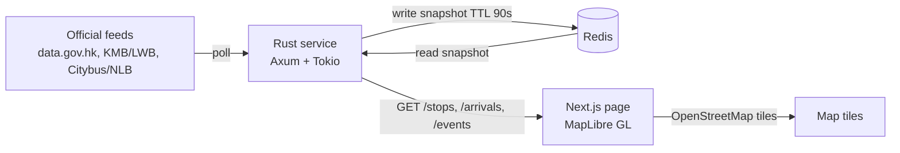

# Realtime HK Traffic

A live map of public-transport stops in Hong Kong. MTR stations, franchised bus
stops, green minibus stops, and taxi stands are drawn as points on an
OpenStreetMap basemap. Tap a stop to see the next arrivals that an official feed
is publishing right now.

There is no sign-in. Every visitor can pan the map and open any stop.

- **Demo:** https://iravan.github.io/realtime-hk-traffic/
- **License:** MIT (see [LICENSE](LICENSE))
- **Stack:** Next.js + MapLibre GL JS on the page, Rust (Axum + Tokio) for the
  API, Redis for the latest arrival snapshots.

## What it does

The page opens on the device location (when the browser grants it) and selects
the nearest stop of the chosen mode. Four tabs switch between the transport
modes:

| Mode | A stop is | What an arrival shows |
| --- | --- | --- |
| **MTR** | A station | The next train on each line that serves the station, plus line service status when the feed includes it |
| **Bus** | One stop for KMB, LWB, Citybus, or New Lantao Bus | Route, destination, minutes (or clock time), and the age of the estimate |
| **Minibus** | A green minibus stop | The same arrival shape, where an official ETA feed exists; otherwise the timetable, marked not live |
| **Taxi** | A taxi stand | The stand's name and location only — Hong Kong publishes no per-vehicle position feed |

Red minibuses, private cars, and live taxi positions are deliberately out of
scope. Taxi stands are places, not vehicles.

### Behaviour

- **Location-aware start.** On load the page asks for the device location,
  marks it, and opens the nearest stop of the active mode. Changing mode
  reselects the nearest stop of that mode. A locate button re-asks the device,
  recentres the map, and reselects, so a visitor who panned away does not have
  to reload.
- **Live arrivals.** The selected stop is ringed on the map. Its sheet loads the
  latest snapshot, soonest first, and then listens on a server-sent event
  (`/stops/{id}/events`) stream for newer snapshots. The page never computes an
  ETA and never calls a transport feed directly.
- **Freshness is visible.** Every snapshot carries the time the server fetched
  it; the sheet shows that age. An expired snapshot says the snapshot is gone,
  but the stop stays on the map.
- **Service hours.** `web/public/service-hours.json` holds the static service
  window for each mode, MTR station, and green-minibus route. Outside its window
  a stop shrinks to a grey dot and cannot be opened. Stops served by an
  overnight route carry `night: true` and stay open and clickable all day.
- **Merged poles.** Feed ids that publish the same coordinate become one point
  with merged arrivals; poles at different coordinates stay separate stops.

## Architecture



The browser never calls data.gov.hk, the bus ETA hosts, or the MTR feed — those
hosts throttle and polling is not a page's job. The Rust process polls each feed
on its own interval, drops stale snapshots, and answers the map. Next.js only
renders.

| Piece | Choice | Role |
| --- | --- | --- |
| Page | Next.js, package manager Bun | Map, mode filters, stop sheet |
| Map | MapLibre GL JS, client only | OpenStreetMap raster basemap and stop layer |
| API | Rust, Axum, Tokio | Poll feeds, serve stops and arrivals |
| Store | Redis | Latest arrival snapshots |
| Clock | Rust process | Refreshes watched stops every 15s and all MTR stations about every 60s |

## Data sources

| Mode | Publisher | Stored |
| --- | --- | --- |
| MTR | MTR next-train feed on data.gov.hk | Station, line, destination, minutes or clock time, fetch time |
| Bus | KMB, LWB, Citybus, and New Lantao Bus ETA feeds | Stop id, route, destination, minutes, fetch time |
| Minibus | Green-minibus ETA feed on data.gov.hk, where a route has one | Same shape as a bus; timetable only when no ETA exists |
| Taxi | Taxi-stand dataset on data.gov.hk | Stand id, name, coordinates (no vehicle positions) |

The exact endpoints, fields read, checked-in snapshots and polling rules are in
[DATA.md](DATA.md).

A stop id is the publisher's id prefixed by its mode, so feeds cannot collide:
`mtr:`, `bus:`, `minibus:`, `taxi:`.

## HTTP API

All routes are public. The service answers both at the root and under `/api`
(for the Vercel rewrite).

```text
GET /stops?south&west&north&east&modes
    { "stops": [ { "id", "mode", "name", "latitude", "longitude" } ] }

GET /stops/{id}/arrivals
    { "fetched_at", "live", "status"?, "note"?, "rows": [ { "route", "destination", "minutes" | "time" } ] }

GET /stops/{id}/events      Server-sent events; each new snapshot is an `arrivals` event
```

`modes` is a comma-separated subset of `mtr,bus,minibus,taxi`. `minutes` is
omitted when a feed gives a clock time instead; that row then has `time`. A taxi
stand returns a name-only snapshot and has no arrivals key. An unknown id is a
404; an expired snapshot is reported as gone, not as an empty timetable.

### Redis

```text
arrivals:{id}    string, EX 90    { "fetched_at", "live", "status"?, "note"?, "rows" }
```

Redis holds only ephemeral arrival snapshots. The stop index (bundled plus live
catalogues) lives in the Rust process memory. See [REDIS.md](REDIS.md).

## Running locally

### Web

```bash
cd web
bun install
bun run dev
```

Open the URL Bun prints. The demo build loads `web/public/stops.json` and
`web/public/service-hours.json`, so the map works without the API. In
development the sheet talks to the Rust server at `http://127.0.0.1:8787`, so
start the server below for live arrivals. Set `NEXT_PUBLIC_API_BASE` to point
somewhere else (for example when the server uses another `BIND`).

### Server

Redis must be running first (defaults to `redis://127.0.0.1:6379`).

```bash
cd server
REDIS_URL=redis://127.0.0.1:6379 BIND=127.0.0.1:8787 cargo run
```

Environment variables:

| Variable | Purpose |
| --- | --- |
| `REDIS_URL` (or `KV_URL` / `UPSTASH_REDIS_URL`) | Redis connection string; `rediss://` works |
| `BIND` | Listen address when `PORT` is not set (default `127.0.0.1:8787`) |
| `PORT` | Injected by Vercel; binds `0.0.0.0:$PORT` |
| `CORS_ORIGINS` | Comma-separated allowed origins for cross-origin page builds |

If Redis is unreachable the process exits within 5 seconds with a clear message
rather than hanging.

## Project layout

```text
web/                 Next.js app (static export)
  app/               Map page, stop sheet, service-hours helpers, icons
  public/            stops.json, service-hours.json, MTR line GeoJSON, icons
  scripts/           MapLibre worker copy step
server/              Rust API (Axum + Tokio)
  src/main.rs        Routes, poll loop, feed fetchers
  src/catalog.rs     Stop catalogues and bundled route data
  data/              Bundled stop seed and green-minibus route map
  scripts/           Catalogue and night-stop generators
```

## Deployment

`vercel.json` declares two services in one project: `web/` as a static Next.js
export and `server/` as a container built from `server/Dockerfile`. Requests to
`/api/*` are routed to the server; everything else goes to the page. See
[DEPLOY.md](DEPLOY.md) for the required environment variables and the GitHub
Pages setup.

## Documentation

- [DESIGN.md](DESIGN.md) — product goal and behaviour
- [TECH-STACK.md](TECH-STACK.md) — stack and feed choices
- [CHECKLIST.md](CHECKLIST.md) — frontend work list
- [server/CHECKLIST.md](server/CHECKLIST.md) — backend work list
- [DEPLOY.md](DEPLOY.md) — Vercel and GitHub Pages deployment
- [REDIS.md](REDIS.md) — Redis key layout
- [MTR.md](MTR.md) — MTR line colours and stations

## License

Released under the [MIT License](LICENSE). Copyright (c) 2026 Ivan.

Map data © OpenStreetMap contributors.
