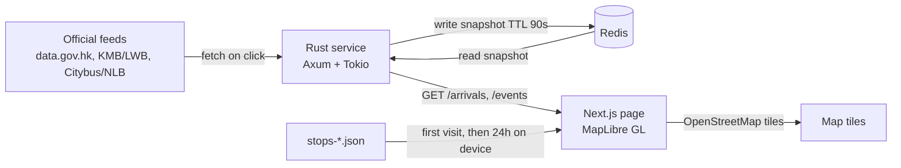

# Realtime HK Traffic

A live map of public-transport stops in Hong Kong. MTR stations, franchised bus
stops, green minibus stops, ferry piers, and taxi stands are drawn as points on
an OpenStreetMap basemap. Tap a stop to see the next arrivals that an official
feed is publishing right now.

There is no sign-in. Every visitor can pan the map and open any stop.

- **Demo:** https://iravan.github.io/realtime-hk-traffic/
- **License:** MIT (see [LICENSE](LICENSE))
- **Stack:** Next.js + MapLibre GL JS on the page, Rust (Axum + Tokio) for the
  API, Redis for the latest arrival snapshots.

## What it does

The page opens on the device location (when the browser grants it) and selects
the nearest stop of the chosen mode. Five tabs switch between the transport
modes:

| Mode | A stop is | What an arrival shows |
| --- | --- | --- |
| **MTR** | A station | The next train on each line that serves the station, plus line service status when the feed includes it |
| **Bus** | One stop for KMB, LWB, Citybus, or New Lantao Bus | Route, destination, minutes (or clock time), and the age of the estimate |
| **Minibus** | A green minibus stop | The same arrival shape, where an official ETA feed exists; otherwise the timetable, marked not live |
| **Ferry** | A ferry pier | Hong Kong & Kowloon Ferry shows the minutes until departure. Sun Ferry shows the published arrival once the boat has left, and the minutes until departure before that. Other piers stay on the map and show that nothing is scheduled right now |
| **Taxi** | A taxi stand | The stand's name and location only — Hong Kong publishes no per-vehicle position feed |

Red minibuses, private cars, and live taxi positions are deliberately out of
scope. Taxi stands are places, not vehicles.

### Behaviour

- **Location-aware start.** On load the page asks for the device location,
  marks it, and opens the nearest stop of the active mode. Changing mode
  reselects the nearest stop of that mode. A locate button re-asks the device,
  recentres the map, and reselects, so a visitor who panned away does not have
  to reload.
- **Live arrivals.** The selected stop is ringed on the map. Its sheet loads the
  latest snapshot, soonest first, and then listens on a server-sent event
  (`/stops/{id}/events`) stream for newer snapshots. The page never computes an
  ETA and never calls a transport feed directly. A bus or ferry destination is
  shown in the language of the page. Citybus publishes one language per
  request, so the server asks for English and Traditional Chinese and pairs
  the two.
- **Stop pins.** Each mode is a static file, `web/public/stops-{mode}.json`.
  The open tab loads its file, and the other modes follow about two seconds
  later. A first visit downloads about 550 KB compressed for all five files;
  the bus file is most of that. The browser keeps each file for 24 hours, so a
  return visit draws the pins without downloading them again. Service hours,
  the MTR lines, taxi-stand types, and ferry timetables stay in that same
  store. The IndexedDB keys and a ferry check are in
  [DATA.md](DATA.md#caching). Panning does not
  ask the server for stops. Below zoom 16 those stops are counted groups; a tap
  on a count zooms in, and at zoom 16 each stop is its own pin. The bus tab and the KMB, LWB, and New Lantao pins
  use the red bus. A Citybus stop (`bus:ctb:`) uses the yellow double-decker
  in `web/public/icons/citybus.svg`, on the map and in the sheet.
- **Freshness is visible.** Every snapshot carries the time the server fetched
  it; the sheet shows that age. An expired snapshot says the snapshot is gone,
  but the stop stays on the map.
- **Service hours.** `web/public/service-hours.json` holds the static service
  window for each mode, MTR station, green-minibus route, and Star Ferry pier.
  Outside its window a stop shrinks to a grey dot and cannot be opened. A ferry
  pier stays coloured and clickable, and its sheet still shows the hours.
  Stops served by an overnight route carry `night: true` and stay open and
  clickable all day.
- **Long waits.** A wait of 60 minutes or more is shown as hours and leftover
  minutes. A shorter wait stays in minutes.
- **Merged poles.** Feed ids that publish the same coordinate become one point
  with merged arrivals; poles at different coordinates stay separate stops.
- **Share a stop.** The stop sheet puts Share and the external-map icon on the
  vehicle-type line, at the right. Each opens a dialog. Share shows the stop
  link and copies it. The map dialog lists Google Maps, Apple Maps, Baidu Maps,
  Amap, and OpenStreetMap. Close stays on the name line.

## Architecture



The browser never calls data.gov.hk, the bus ETA hosts, or the MTR feed — those
hosts throttle and fetching is not a page's job. The Rust process fetches a
stop when its sheet opens, keeps the snapshot for 90 seconds, and answers the
map. Next.js only renders.

| Piece | Choice | Role |
| --- | --- | --- |
| Page | Next.js, package manager Bun | Map, mode filters, stop sheet |
| Map | MapLibre GL JS, client only | OpenStreetMap raster basemap and stop layer |
| API | Rust, Axum, Tokio | Fetch a stop on click, serve stops and arrivals |
| Store | Redis | Latest arrival snapshots |
| Clock | Rust process | Writes `fetched_at` when a click misses the 90s cache |

## Data sources

| Mode | Publisher | Stored |
| --- | --- | --- |
| MTR | MTR next-train feed on data.gov.hk | Station, line, destination, minutes or clock time, fetch time |
| Bus | KMB, LWB, Citybus, and New Lantao Bus ETA feeds | Stop id, route, destination, minutes, fetch time |
| Minibus | Green-minibus ETA feed on data.gov.hk, where a route has one | Same shape as a bus; timetable only when no ETA exists |
| Ferry | Transport Department pier list, plus Hong Kong & Kowloon Ferry and Sun Ferry ETA feeds | Pier id, name, coordinates, and the live departure or arrival where a feed exists |
| Taxi | Taxi-stand dataset on data.gov.hk | Stand id, name, coordinates (no vehicle positions) |

The exact endpoints, fields read, checked-in snapshots and request limits are in
[DATA.md](DATA.md).

A stop id is the publisher's id prefixed by its mode, so feeds cannot collide:
`mtr:`, `bus:`, `minibus:`, `ferry:`, `taxi:`.

The same id is the share link, with slashes instead of colons and a trailing
slash: `/mtr/CEN/`, `/bus/kmb/{stop}/`, `/bus/ctb/{stop}/`, `/minibus/{id}/`,
`/ferry/{id}/`, `/taxi/{id}/`. Opening that path selects the stop and moves the map so the
whole sign stays clear of the sheet. An older `?stop=` link still opens the
stop, then the address bar switches to the slash form. Closing the sheet or
changing mode returns the address to `/`. On Vercel those paths are rewritten
to the web app. A static host serves the same page from `404.html`.

## Updating catalogues

The server can pick up the latest official stop lists at startup with
`LIVE_CATALOGUES=1`, but that only changes the in-memory catalogue. The canonical
bundled catalogue is `server/data/stops.json`; the web copy is generated from
it during the web build.

### 1. Refresh the base stop list

Start the server with live catalogues and wait for the `catalogue ready` log:

```bash
cd server
LIVE_CATALOGUES=1 cargo run
```

In another terminal, export the merged catalogue and merge it into
`server/data/stops.json`. The merge keeps existing ids, including ids that share
a location, and preserves `routes` and `night` fields.

```bash
curl -s 'http://127.0.0.1:8787/stops?south=-90&west=-180&north=90&east=180' -o /tmp/stops-live.json

python3 - <<'PY'
import json
from pathlib import Path

live = {
    stop["id"]: stop
    for stop in json.load(open("/tmp/stops-live.json", encoding="utf-8"))["stops"]
}
if not live:
    raise SystemExit("no live stops; wait for catalogue ready and retry")

path = Path("server/data/stops.json")
document = json.loads(path.read_text(encoding="utf-8"))
known = {stop["id"] for stop in document["stops"]}

for stop in document["stops"]:
    fresh = live.get(stop["id"])
    if fresh:
        for key in ("mode", "name", "latitude", "longitude"):
            stop[key] = fresh[key]

document["stops"].extend(
    sorted(
        (stop for stop in live.values() if stop["id"] not in known),
        key=lambda stop: stop["id"],
    )
)
path.write_text(
    json.dumps(document, ensure_ascii=False, separators=(",", ":")) + "\n",
    encoding="utf-8",
)
PY
```

New stops are appended without `routes` or `night`; the scripts below fill those
in. Stops removed upstream are not deleted automatically. Remove them by hand if
the catalogue has shrunk.

The page loads one mode at a time. `web/scripts/split-stops.mjs` runs before
dev and build, copies `server/data/stops.json` to `web/public/stops.json`, and
writes `web/public/stops-{bus,minibus,ferry,taxi,mtr}.json`. Both the full web copy and
the per-mode files are generated and ignored by Git.

### 2. Minibus route numbers and stop routes

```bash
python3 server/scripts/fetch-minibus-routes.py --routes-only
```

Builds `server/data/gmb-routes.json` from the cached `KML_GMB.zip` and exits
without calling the GMB API. A full run without `--routes-only` also refreshes
the `routes` arrays in `server/data/stops.json` and merges API route details over
the KML map for new routes. Responses are cached under `.cache/gmb`; the
publisher throttles bursts, so a large refresh may need several runs with
`--budget N`. Use `--refresh-kml` to download the KML archive again.

### 3. Night-stop flags

```bash
python3 server/scripts/fetch-night-stops.py
```

Rewrites `night` on `server/data/stops.json`. It uses the cached minibus data, so
run the minibus script first when minibus routes changed. This script also
accepts `--budget N` and caches responses under `.cache/night`.

### 4. MTR station metadata

`server/data/mtr.json` is checked in. When MTR adds or renames a station or
changes line membership, update it from the official
[MTR lines and stations CSV](https://opendata.mtr.com.hk/data/mtr_lines_and_stations.csv).
Keep the coordinates and include `RAC` (Racecourse), which the CSV omits.

Then sync the bundled stop list and line-terminal labels:

```bash
python3 server/scripts/build-mtr-catalogue.py
```

This updates the `mtr:` rows in `server/data/stops.json` and writes
`web/app/mtr-line-terminals.json`. The CSV is cached under `.cache/mtr`; use
`--refresh` to download it again.

### 5. MTR line geometry

```bash
python3 server/scripts/fetch-mtr-lines.py --refresh
```

Rewrites `web/public/mtr-lines.geojson` from OpenStreetMap/Overpass.

### 6. Service hours

`web/public/service-hours.json` is checked-in schedule data. Update it by hand
when a mode, station or route changes its service window. Star Ferry piers are
route entries keyed by stop id: Central Pier 7 (`ferry:101339`) and Tsim Sha
Tsui (`ferry:101119`) run 06:30–23:30, and Wan Chai (`ferry:101118`) runs
07:30–23:00. Other piers use the ferry default, 03:00–01:00. On Sundays and
public holidays the first Wan Chai boat is 07:40; the stored window opens with
the Monday–Saturday boat. A ferry sheet lists destination, first boat, and
last boat from `web/public/ferry-services.json` when that pier is in the
file, including the Lamma and outlying kaitos that publish those times, and
keeps this window only when it is not. Rebuild that file with
`python3 server/scripts/fetch-ferry-berths.py`.

### 7. Ferry piers

```bash
python3 server/scripts/fetch-ferry-stops.py
```

Rewrites the `ferry:` rows in `server/data/stops.json` from the Transport
Department stop sequence and the CSDI pier coordinates, and rewrites
`server/data/ferry-departures.json`. That file maps a pier to the Hong Kong &
Kowloon Ferry and Sun Ferry routes that leave it. Rebuild the server after
either file changes.

### 7. Check the result

The web build regenerates the web copy and per-mode files from the canonical
catalogue:

```bash
cd web && bun run build
cmp public/stops.json ../server/data/stops.json
```

Then run the normal checks:

```bash
cd server && cargo fmt --check && cargo check && cargo test
cd ../web && bunx tsc --noEmit && bun run build
```

`server/data/stops.json` is the canonical catalogue and is compiled into the
server binary, so rebuild and redeploy the server after changing it. The web
build needs a new static export when `server/data/stops.json`,
`web/app/mtr-line-terminals.json`, `service-hours.json` or `mtr-lines.geojson`
changes. Leave `LIVE_CATALOGUES` unset in production unless you want the slower
live catalogue refresh at startup.

## HTTP API

All routes are public. The service answers both at the root and under `/api`
(for the Vercel rewrite).

```text
GET /stops?south&west&north&east&modes
    { "stops": [ { "id", "mode", "name", "latitude", "longitude" } ] }

GET /stops/{id}/arrivals
    { "fetched_at", "live", "status"?, "note"?, "rows": [ { "route", "destination", "minutes" | "time" } ] }

GET /stops/{id}/events      Server-sent events; each new snapshot is an `arrivals` event
```

`modes` is a comma-separated subset of `mtr,bus,minibus,ferry,taxi`. `minutes` is
omitted when a feed gives a clock time instead; that row then has `time`. A taxi
stand returns a name-only snapshot and has no arrivals key. An unknown id is a
404; an expired snapshot is reported as gone, not as an empty timetable.

### Redis

```text
arrivals:{id}    string, EX 90    { "fetched_at", "live", "status"?, "note"?, "rows" }
```

Redis holds only ephemeral arrival snapshots. The stop index (bundled, with an
optional live catalogue refresh) lives in the Rust process memory. See
[REDIS.md](REDIS.md).

## Running locally

### Web

```bash
cd web
bun install
bun run dev
```

Open the URL Bun prints. The demo build loads the generated per-mode stop files
(`web/public/stops-*.json`) and `web/public/service-hours.json`, so the map works
without the API. The browser keeps each mode's stop file, the service hours,
the MTR lines, the taxi stands, and the ferry timetables for 24 hours. In development the sheet talks to the Rust server at
`http://127.0.0.1:8787`, so start the server below for live arrivals. Set
`NEXT_PUBLIC_API_BASE` to point somewhere else (for example when the server uses
another `BIND`).

### Server

Redis must be running first (defaults to `redis://127.0.0.1:6379`).

```bash
cd server
REDIS_URL=redis://127.0.0.1:6379 BIND=127.0.0.1:8787 cargo run
```

Environment variables:

| Variable | Purpose |
| --- | --- |
| `REDIS_URL` (or `KV_URL` / `UPSTASH_REDIS_URL`) | Redis connection string; `rediss://` works |
| `BIND` | Listen address when `PORT` is not set (default `127.0.0.1:8787`) |
| `PORT` | Injected by Vercel; binds `0.0.0.0:$PORT` |
| `CORS_ORIGINS` | Comma-separated allowed origins for cross-origin page builds |
| `LIVE_CATALOGUES` | Optional. Set to `1` to refresh bus, minibus and taxi catalogues from upstream at startup; by default the server uses the bundled catalogue |

If Redis is unreachable the process exits within 5 seconds with a clear message
rather than hanging.

## Project layout

```text
web/                 Next.js app (static export)
  app/               Map page, stop sheet, service-hours helpers, icons
  public/            stops.json, service-hours.json, MTR line GeoJSON, icons
  scripts/           MapLibre worker copy step
server/              Rust API (Axum + Tokio)
  src/main.rs        Routes and feed fetchers
  src/catalog.rs     Stop catalogues and bundled route data
  data/              Bundled stop seed, green-minibus route map, ferry departures
  scripts/           Catalogue and night-stop generators
```

## Deployment

`vercel.json` declares two services in one project: `web/` as a static Next.js
export and `server/` as a container built from `server/Dockerfile`. Requests to
`/api/*` are routed to the server; everything else goes to the page. See
[DEPLOY.md](DEPLOY.md) for the required environment variables and the GitHub
Pages setup.

## Documentation

- [DESIGN.md](DESIGN.md) — product goal and behaviour
- [TECH-STACK.md](TECH-STACK.md) — stack and feed choices
- [CHECKLIST.md](CHECKLIST.md) — frontend work list
- [server/CHECKLIST.md](server/CHECKLIST.md) — backend work list
- [DEPLOY.md](DEPLOY.md) — Vercel and GitHub Pages deployment
- [REDIS.md](REDIS.md) — Redis key layout
- [MTR.md](MTR.md) — MTR line colours and stations

## License

Released under the [MIT License](LICENSE). Copyright (c) 2026 Ivan.

Map data © OpenStreetMap contributors.
