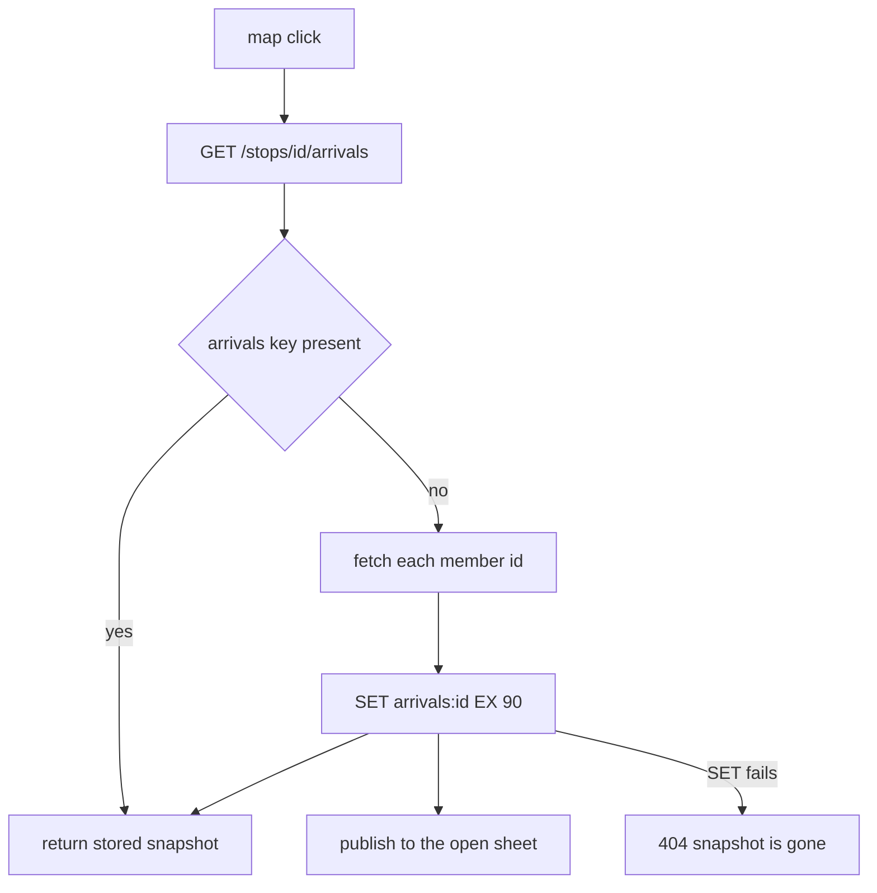

# Redis keys

One key family is used at runtime; a second was removed.

## `arrivals:{stop_id}` — string, TTL 90s

- Value: `{ "fetched_at", "live", "status"?, "note"?, "rows": [ ... ] }`
- Written by `refresh()` in `server/src/main.rs`. See [On click](#on-click).
- Read by `read_snapshot()` (`GET arrivals:{id}`) in the `arrivals` handler.
- Expiry: `EX 90` (`ETA_TTL_SECS`).
- On write failure the snapshot is not cached. The handler answers 404 and the next click tries again.

## On click

There is no background poll. A map click opens the sheet, which calls `GET /stops/{id}/arrivals`. If `arrivals:{id}` is still in Redis, that response is the stored snapshot and the feed is not called. If the key is missing, `refresh()` fetches each member id, merges the rows, and `SET arrivals:{id} EX 90`.

The sheet also opens `/stops/{id}/events`. That stream receives the snapshot from this fetch. It does not schedule another one. Taxi stands never call a feed.

## `stop:{id}` — removed

Previously written at cold start for every catalogue stop, with **no TTL** and **never read**.
The stop index is kept in memory (`by_id` / `stops`), so this key was dead weight that
accumulated on every deploy and could exhaust the store. Removed; Redis now only holds
the ephemeral `arrivals:{id}` snapshots.

## Operational notes

- Redis is required to start: the process fails fast (5s) if it cannot connect.
- URL source, in order: `REDIS_URL`, `KV_URL`, `UPSTASH_REDIS_URL`. `rediss://` (TLS) works.
- After upgrading from a build that wrote `stop:*`, clear the leftovers once with
  `FLUSHDB` (or `DEL stop:*`).
